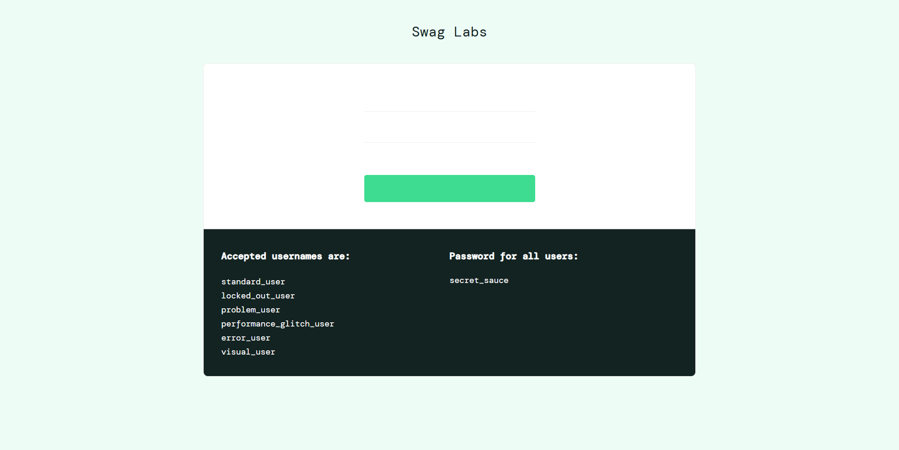

# LAB 02 – SELENIUM WEBDRIVER CƠ BẢN

**Họ và tên:** Ngô Nguyễn Ngọc Minh  
**Mã sinh viên:** TB01963
**Nhóm:** 07

## A. LOCATOR ANALYSIS

Website kiểm thử: https://www.saucedemo.com/

### 1. Username

- Locator 1: `By.Id("user-name")`
- Locator 2: `By.Name("user-name")`
- Locator được chọn: `By.Id("user-name")`
- Lý do: ID xác định trực tiếp phần tử, ngắn gọn và dễ sử dụng.

### 2. Password

- Locator 1: `By.Id("password")`
- Locator 2: `By.Name("password")`
- Locator được chọn: `By.Id("password")`
- Lý do: ID rõ ràng, dễ xác định và sử dụng trong Selenium.

### 3. Login Button

- Locator 1: `By.Id("login-button")`
- Locator 2: `By.Name("login-button")`
- Locator được chọn: `By.Id("login-button")`
- Lý do: ID duy nhất, giúp xác định chính xác nút đăng nhập.

### 4. Product Name

- Locator 1: `By.ClassName("inventory_item_name")`
- Locator 2: `By.CssSelector("[data-test='inventory-item-name']")`
- Locator được chọn: `By.CssSelector("[data-test='inventory-item-name']")`
- Lý do: Thuộc tính `data-test` được thiết kế để hỗ trợ kiểm thử, giúp locator dễ đọc và ổn định.

### 5. Product Price

- Locator 1: `By.ClassName("inventory_item_price")`
- Locator 2: `By.CssSelector("[data-test='inventory-item-price']")`
- Locator được chọn: `By.CssSelector("[data-test='inventory-item-price']")`
- Lý do: Thuộc tính `data-test` giúp xác định chính xác phần tử giá sản phẩm.

## B. SCREENSHOTS – LOCATOR VERIFICATION

Chèn ảnh kết quả kiểm tra locator bằng DevTools Ctrl + F tại đây.

- Ảnh A1: Username.
- Ảnh A2: Password.
- Ảnh A3: Login Button.
- Ảnh A4: Product Name.
- Ảnh A5: Product Price.

## D. AI INTEGRATION

### 1. Element được chọn

Tên phần tử: Nút Add to cart của sản phẩm Sauce Labs Backpack.

### 2. HTML của phần tử

Dán nội dung `outerHTML` đã sao chép từ DevTools vào đây.

### 3. Prompt sử dụng AI

Dựa vào đoạn HTML của nút Add to cart, hãy đề xuất hai locator Selenium bằng C#. Ưu tiên sử dụng ID hoặc thuộc tính data-test. Giải thích locator nào ổn định và phù hợp hơn khi viết kiểm thử tự động.

### 4. Kết quả AI đề xuất

- Locator 1: `By.Id("add-to-cart-sauce-labs-backpack")`
- Locator được chọn: `By.Id("add-to-cart-sauce-labs-backpack")`

### 5. Kiểm tra locator

Sử dụng DevTools Ctrl + F để kiểm tra locator:

`#add-to-cart-sauce-labs-backpack`

Kết quả mong đợi: `1 of 1`.

### 6. Nhận xét

AI đề xuất locator sử dụng ID cho nút Add to cart. Đây là locator ngắn gọn và dễ sử dụng trong Selenium. Sau khi kiểm tra bằng DevTools, có thể xác
định locator có tìm đúng phần tử hay không. Việc sử dụng AI giúp tiết kiệm thời gian và hỗ trợ lựa chọn locator phù hợp hơn.

---

# Lab 3 - Xử lý các tình huống thực tế phức tạp

## Cấu trúc
- BaseTest.cs: SetUp, [TearDown] chụp ảnh khi test Failed, hàm đăng nhập
- DynamicLoadingTests.cs: Phần A
- SortTests.cs: Phần B
- AlertIframeTests.cs: Phần C
- ScreenshotDemoTests.cs: Phần D (test cố ý rớt)
- Thư mục screenshots/: ảnh minh chứng

## Phần A - Chứng minh vấn đề đồng bộ
Trang: https://the-internet.herokuapp.com/dynamic_loading/2

- Bước 1 (không Wait): test rớt với NoSuchElementException
  
- Bước 2 (WebDriverWait + Until): test PASS
  

Giải thích: Cùng lệnh FindElement(By.Id("finish")) nhưng ở Bước 1 chạy ngay sau khi bấm Start, lúc JavaScript chưa tạo phần tử #finish nên Selenium ném NoSuchElementException. Selenium chỉ tự chờ khi chuyển trang, không chờ phần tử do JavaScript tạo ra sau đó. Ở Bước 2, WebDriverWait + Until thử tìm lại liên tục (tối đa 10 giây) đến khi #finish xuất hiện nên test PASS ổn định. Không dùng Thread.Sleep và không dùng Implicit Wait.

## Phần B - Dropdown và Assert đúng nghiệp vụ
SortTests.cs dùng SelectElement chọn Price (low to high), lấy 6 giá, bỏ ký tự $, chuyển sang số và Assert danh sách thực sự tăng dần.

## Phần C - Alert và iframe
AlertIframeTests.cs xử lý Alert (Accept), Confirm (Dismiss), Prompt (SendKeys + Accept), có Assert nội dung #result; iframe dùng SwitchTo().Frame rồi DefaultContent().

## Phần D - Chụp ảnh khi test thất bại
[TearDown] trong BaseTest.cs chỉ chụp khi Outcome.Status == TestStatus.Failed, đặt tên file theo tên ca test, đính kèm bằng TestContext.AddTestAttachment. Ảnh minh chứng (test D1 cố ý rớt):

## Phần E - Ghi nhận dùng AI để chẩn đoán flaky test
- Test chọn: A1_KhongWait_RotNoSuchElement (rớt 5/5 lần chạy)
- Prompt đã dùng: [dán prompt bạn đã gửi AI]
- AI sử dụng: Gemini
- Nguyên nhân AI đề xuất: thiếu Explicit Wait (JavaScript tạo phần tử bất đồng bộ); mạng chậm; CPU/CI chậm; phần tử bị ẩn lúc đầu
- Tự kiểm chứng: [kết quả F12, chạy A2 [x]/10 lần xanh...]
- Nhận xét: [dán nhận xét 3-5 câu của bạn]