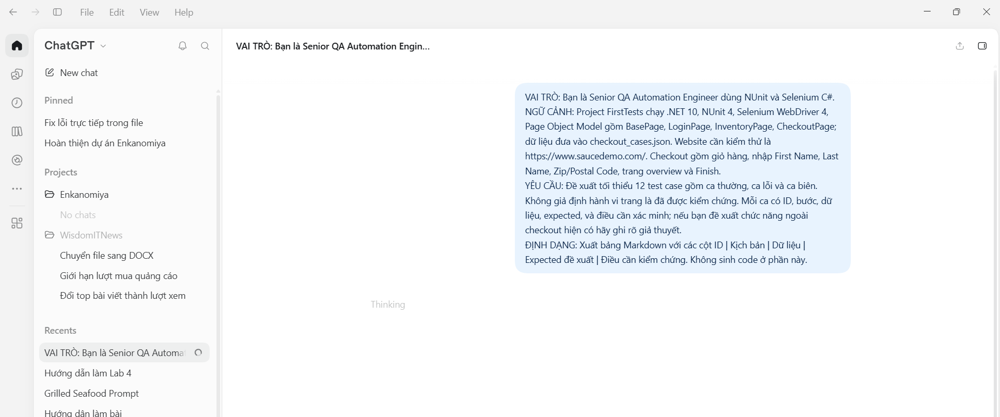
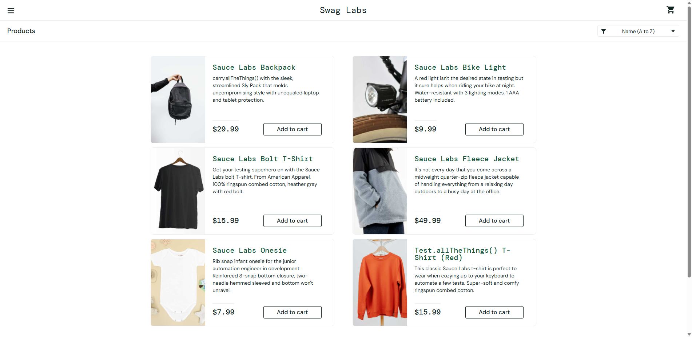
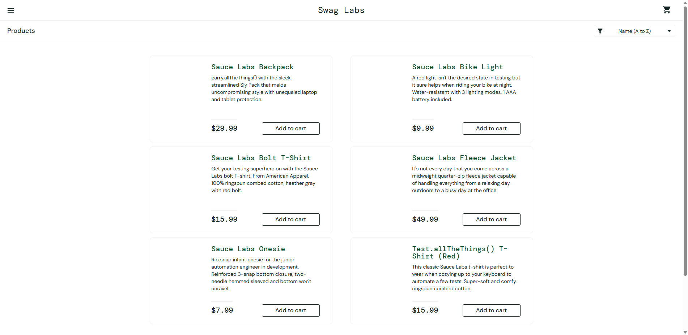

# LAB 07 – KHAI THÁC AI CHUYÊN SÂU TRONG QUY TRÌNH KIỂM THỬ

| | |
|---|---|
| **Họ và tên** | Trần Nguyễn Bình Yên |
| **Mã sinh viên** | TB01913 |
| **Nhóm** | 07 |
| **Môn học** | SOF3091 – Kiểm thử nâng cao cùng AI (.NET) |
| **Ngày báo cáo** | 23/11/2026 |
| **Website kiểm thử** | https://www.saucedemo.com/ |
| **Công nghệ** | C#, .NET 10, NUnit 4, Selenium WebDriver 4, Page Object Model |
| **Kết quả NUnit** | **19 Passed, 0 Failed** (lượt Run All lúc 18:33:29 ngày 23/11/2026) |
| **Ca chạy riêng** | `D01` (`[Explicit]`): **Failed có chủ đích** để làm Phần D |

> README này giải thích Lab 7 từ đầu đến cuối: cách mở và chạy dự án, cấu trúc thư mục, từng phần A–E của đề, kết quả đã chạy và những việc còn lại. README tổng Lab 1–7 nằm ở file riêng.

## Mục lục
1. [Lab 7 làm gì?](#lab7-lam-gi)
2. [Bảng tiêu chí và trạng thái](#bang-tieu-chi)
3. [Cách mở và chạy dự án](#cach-chay)
4. [Cấu trúc thư mục](#cau-truc)
5. [Phần A đến E](#phan-a)
6. [Cơ chế báo cáo và ảnh](#co-che-bao-cao)
7. [Kết quả đã chạy](#ket-qua)
8. [Điểm đã chỉnh so với source mẫu](#diem-chinh)
9. [Việc còn lại](#viec-con-lai)
10. [Commit gợi ý](#commit)
11. [Khắc phục lỗi khởi động](#khac-phuc)


<a id="lab7-lam-gi"></a>

## Lab 7 làm gì?

Lab 7 yêu cầu dùng AI (ChatGPT ở Phần A) như **trợ lý** trong quy trình kiểm thử, theo ba việc:

1. **Sinh ca kiểm thử** cho chức năng thanh toán (Checkout) của SauceDemo.
2. **Viết và thẩm định code** theo Page Object Model (POM).
3. **Chẩn đoán lỗi** từ stack trace thật rồi sửa.

Nguyên tắc xuyên suốt: AI chỉ *đề xuất*; người học phải *thẩm định* từng đề xuất (GIỮ / SỬA / BỎ), chạy thật và đối chiếu với giao diện. Câu trả lời của AI **không** được coi là bằng chứng đã kiểm thử.

<a id="bang-tieu-chi"></a>

## Bảng tiêu chí và trạng thái

| Phần | Yêu cầu của đề | Trọng số | Bài làm | Trạng thái |
|---|---|---:|---|---|
| A | Prompt đủ 4 thành phần; AI đề xuất ca thường, lỗi, biên | 20% | Prompt gửi ChatGPT; nhận 20 ca C01–C20 | Đủ |
| B | Thẩm định GIỮ / BỎ / SỬA; giải thích loại ít nhất 3 ca | 15% | 5 GIỮ, 11 SỬA, 4 BỎ (đều có lý do) | Đủ |
| C | Sinh Page Object hoặc test mới; checklist 6 điểm; chạy build và test | 25% | Test data-driven qua POM; 19 ca Passed | **Thiếu ảnh** terminal (C08) và ảnh AI sinh code (C09) |
| D | Debug từ stack trace: tự đoán, hỏi AI, sửa, ảnh trước/sau | 25% | D01 Failed rồi D02 Passed; có prompt kèm stack trace thật | Đủ |
| E | Chỉ ra ít nhất 1 lỗi của AI hoặc chứng minh đã rà checklist | 15% | 7 nhóm lỗi trong câu trả lời ChatGPT | Đủ |

<a id="cach-chay"></a>

## Cách mở và chạy dự án

**Yêu cầu:** Visual Studio 2026 (hoặc VS Code), .NET 10 SDK, trình duyệt Chrome, kết nối Internet (để truy cập SauceDemo).

**Cách 1 – Visual Studio**
1. Giải nén **nguyên thư mục `Lab7`** vào một thư mục mới, mở `Lab7.slnx`.
2. NuGet tự Restore. Mở **Test > Test Explorer**.
3. Chọn **Run All** để chạy 19 ca (hoặc Run Selected cho từng ca).
4. Muốn chạy ca Failed của Phần D: trong Test Explorer bấm chuột phải `D01_TruocSua_LocatorSai_CoYFailed` rồi chọn **Run**. Ca này là `[Explicit]` nên **không** chạy khi Run All.

**Cách 2 – dòng lệnh** (tại thư mục `Lab7`)

```powershell
dotnet build .\Lab7.slnx
dotnet test  .\Lab7.slnx
```

**Cấu hình** nằm ở `FirstTests/Config/appsettings.json`:

```json
{
  "BaseUrl": "https://www.saucedemo.com/",
  "Browser": "chrome",
  "TimeoutSeconds": 10,
  "Headless": true,
  "WindowWidth": 1920,
  "WindowHeight": 1080
}
```
Mặc định Chrome chạy ẩn (`Headless: true`); đặt `false` nếu muốn quan sát trình duyệt. `TimeoutSeconds` là thời gian tối đa `Tim(By)` chờ một phần tử.

<a id="cau-truc"></a>

## Cấu trúc thư mục

```text
Lab7/
├── Lab7.slnx                      Solution (mở file này)
├── README.md                      File bạn đang đọc
├── DeBai.pdf                      Đề Lab 7
├── BaoCao_Lab7_TB01913.docx       Báo cáo Word (Phần A–E, sản phẩm nộp)
├── FirstTests/                    Mã nguồn C#
│   ├── Config/                    appsettings.json, ConfigReader, TestConfig
│   ├── Core/                      BaseTest (SetUp/TearDown, chụp ảnh, log), DriverFactory
│   ├── Data/                      checkout_cases.json (6 ca), users.json
│   ├── Pages/                     BasePage, LoginPage, InventoryPage, CheckoutPage, DebugLocatorPage
│   ├── Tests/                     DataDrivenCheckoutTests, DataDrivenLoginTests,
│   │                              LoginTests, LAB07_DebugTruocSuaTests
│   ├── Utilities/                 Log, ScreenshotHelper
│   └── Reporting/                 Xuất TestReport.pdf / .xlsx / .html sau mỗi lượt Run
├── screenshots/                   Ảnh Selenium tự chụp sau mỗi test (một thư mục phẳng)
│   └── minhchung/                 Ảnh hội thoại AI, giao diện, DevTools
├── TestReport/                    TestReport*.pdf/.xlsx/.html và NhatKy_*.log
├── TieuChiTest/PhanA … PhanE      Yêu cầu và minh chứng theo từng phần của đề
├── TaiLieuAI/                     Prompt, câu trả lời AI, bảng GIỮ/BỎ/SỬA, checklist, ghi chép debug
└── CongCu/                        Script PowerShell thu thập minh chứng và chèn ảnh vào Word
```

**19 ca của lượt Run All:** `DataDrivenCheckoutTests` 6 ca (thanh toán theo JSON) · `DataDrivenLoginTests` 6 ca (đăng nhập theo JSON) · `LoginTests` 6 ca (đăng nhập, tài khoản bị khóa, nhiều tài khoản) · `LAB07_DebugTruocSuaTests` 1 ca (D02). Ca D01 là `[Explicit]` nên không nằm trong 19 ca.

**Các file C# quan trọng**
- `Tests/DataDrivenCheckoutTests.cs`: `TestCaseSource` đọc `Data/checkout_cases.json`, đi qua LoginPage → InventoryPage → CheckoutPage.
- `Pages/InventoryPage.cs`: `ThemBackpack()`, `MoGioHang()`.
- `Pages/CheckoutPage.cs`: `BatDau()`, `NhapThongTin()`, `LayThongBaoLoi()`, `HoanTatVaLayThongBao()`.
- `Tests/LAB07_DebugTruocSuaTests.cs`: D01 (cố ý Failed, `[Explicit]`) và D02 (đã sửa).
- `Core/BaseTest.cs`: SetUp/TearDown, chụp ảnh, ghi log. `Reporting/`: tạo PDF, Excel, HTML từ kết quả NUnit.

<a id="phan-a"></a>

## A. Prompt và danh sách ca kiểm thử do AI đề xuất (20%)

**Chức năng chọn:** thêm sản phẩm vào giỏ, rồi thanh toán trên https://www.saucedemo.com/ (đăng nhập, Add to cart, giỏ hàng, Checkout, nhập First Name / Last Name / Postal Code, Continue, Overview, Finish).

**Prompt gửi ChatGPT** gồm đủ bốn thành phần:

| Thành phần | Nội dung trong prompt |
|---|---|
| Vai trò | Senior QA Automation Engineer dùng NUnit và Selenium C# |
| Ngữ cảnh | .NET 10, NUnit 4, Selenium 4, POM (BasePage, LoginPage, InventoryPage, CheckoutPage), dữ liệu `checkout_cases.json` |
| Yêu cầu | Tối thiểu 12 ca gồm ca thường, ca lỗi, ca biên; không coi hành vi trang là đã kiểm chứng; ghi rõ giả thuyết |
| Định dạng | Bảng Markdown 5 cột `ID / Kịch bản / Dữ liệu / Expected đề xuất / Điều cần kiểm chứng`; không sinh code |

Prompt nguyên văn và toàn bộ bảng trả lời: `TaiLieuAI/PhanA_PromptVaDanhSachAI.md`.

**Kết quả AI trả về: 20 ca** (cột "Nhóm" do người thẩm định gán để thống kê):

| Nhóm | Số ca | Các ca | Nội dung chính |
|---|---:|---|---|
| Thường | 6 | C01, C02, C03, C17, C18, C19 | Thanh toán hợp lệ; 2 sản phẩm; xóa sản phẩm khỏi giỏ; Cancel ở hai màn hình; đối chiếu tiền ở Overview |
| Lỗi | 8 | C04 đến C11 | Giỏ rỗng; để trống First Name / Last Name / Postal Code / cả ba; ba ô chỉ chứa khoảng trắng |
| Biên | 6 | C12 đến C16, C20 | Tiếng Việt có dấu; ký tự đặc biệt; tên 256 ký tự; Postal Code `00123` và `SW1A 1AA`; tải lại trang hoàn tất |

**Ảnh hội thoại thật với ChatGPT:** [A01a – prompt](screenshots/minhchung/A01a_ChatGPT_Prompt.png) · [A01b – C01 đến C03](screenshots/minhchung/A01b_ChatGPT_TraLoi_C01-C03.png) · [A01c – C03 đến C11](screenshots/minhchung/A01c_ChatGPT_TraLoi_C03-C11.png) · [A01d – C11 đến C18](screenshots/minhchung/A01d_ChatGPT_TraLoi_C11-C18.png) · [A01e – C14 đến C20](screenshots/minhchung/A01e_ChatGPT_TraLoi_C14-C20.png)



## B. Thẩm định GIỮ / BỎ / SỬA (15%)

Quy ước: **GIỮ** = dùng ý tưởng của ca (đã hoặc đang triển khai); **SỬA** = giữ ý tưởng nhưng phải sửa Expected, dữ liệu hoặc bổ sung Page Object; **BỎ** = không đưa vào bộ test.
"Ca JSON 01–06" là sáu ca thật trong `FirstTests/Data/checkout_cases.json` (xem Phần C).

| ID | Quyết định | Căn cứ |
|---|---|---|
| C01 | **GIỮ** | Luồng thuận; trùng ca JSON 01 (John / Doe / 10000), đã Passed. |
| C02 | SỬA | Cần thêm sản phẩm thứ hai và đọc Item total, Tax, Total ở Overview; Expected phải là công thức cụ thể. |
| C03 | SỬA | Chưa có Page Object cho giỏ hàng; "số lượng cập nhật" phải đổi thành giá trị cụ thể (badge biến mất, giỏ trống). |
| C04 | **BỎ** | Quy tắc "không cho hoàn tất đơn rỗng" do AI tự đặt, không có trong luồng đã khảo sát. |
| C05 | SỬA | Chưa có ca riêng trong JSON; Expected phải ghi đúng chuỗi `Error: First Name is required`. |
| C06 | **GIỮ** | Trùng ca JSON 03; Expected thay bằng `Error: Last Name is required`, đã Passed. |
| C07 | **GIỮ** | Trùng ca JSON 04; Expected thay bằng `Error: Postal Code is required`, đã Passed. |
| C08 | **GIỮ** | Trùng ca JSON 02; cả ba ô trống chỉ hiện `Error: First Name is required`, đã Passed. |
| C09 | SỬA | Quy tắc xử lý khoảng trắng chưa xác nhận; chạy thử thủ công rồi mới viết Expected. |
| C10 | SỬA | Như C09, áp dụng cho Last Name. |
| C11 | SỬA | Như C09, áp dụng cho Postal Code. |
| C12 | **GIỮ** | Được phủ bởi ca JSON 06 (có dấu tiếng Việt), đã Passed. |
| C13 | SỬA | Expected có nhánh "hoặc"; ca JSON 06 cho thấy ký tự đặc biệt được chấp nhận nên Expected = hoàn tất đơn hàng. |
| C14 | SỬA | Chưa biết giới hạn độ dài; thử thủ công để xác định rồi mới viết Expected. |
| C15 | **BỎ** | Postal Code không hiển thị lại ở Overview và Complete nên không có gì để Assert. |
| C16 | **BỎ** | Trùng ca JSON 05 và 06 (Postal Code "1", "70000!" đều hoàn tất); Expected chỉ có điều kiện "nếu hệ thống hỗ trợ". |
| C17 | SỬA | Chưa có phương thức Cancel trong `CheckoutPage`; phải quan sát trang đích thật rồi gán Expected. |
| C18 | SỬA | Như C17, áp dụng cho nút Cancel ở Overview. |
| C19 | SỬA | Expected phải có số: Total = Item total + Tax, đọc từ trang; không đặt cứng thuế suất. |
| C20 | **BỎ** | Luồng không có màn hình liệt kê đơn hàng để so sánh trước và sau khi tải lại. |

**Tổng hợp:** GIỮ 5 (C01, C06, C07, C08, C12) · SỬA 11 · BỎ 4 (C04, C15, C16, C20).
Ảnh đối chiếu giao diện: [B01 – Your Information](screenshots/minhchung/B01_Checkout_YourInformation.png) · [B02a – Your Information](screenshots/minhchung/B02a_Checkout_YourInformation.png) · [B02b – Overview](screenshots/minhchung/B02b_Checkout_Overview.png).

## C. Code theo Page Object Model, checklist 6 điểm, build và test (25%)

**Luồng test** (`FirstTests/Tests/DataDrivenCheckoutTests.cs`): mỗi dòng trong `Data/checkout_cases.json` là một ca NUnit (`[TestCaseSource]`).

```csharp
var checkoutPage = new LoginPage(driver)
    .DangNhap("standard_user", "secret_sauce")   // LoginPage -> InventoryPage
    .ThemBackpack()                               // InventoryPage
    .MoGioHang();                                 // -> CheckoutPage

checkoutPage.BatDau().NhapThongTin(caTest.Ten, caTest.Ho, caTest.MaBuuChinh);

if (caTest.MongDoiThanhCong)
    Assert.That(checkoutPage.HoanTatVaLayThongBao(), Is.EqualTo("Thank you for your order!"));
else
    Assert.That(checkoutPage.LayThongBaoLoi(), Is.EqualTo(caTest.ThongBaoLoi));
```

**Sáu ca dữ liệu thật** (`checkout_cases.json`), cả sáu đều Passed:

| Ca | Tên ca | First / Last / Postal | Kết quả mong đợi |
|---:|---|---|---|
| 01 | CaThuong_HopLe | John / Doe / 10000 | Thank you for your order! |
| 02 | CaLoi_DeTrongTatCa | (trống) / (trống) / (trống) | Error: First Name is required |
| 03 | CaLoi_DeTrongHo | John / (trống) / 10000 | Error: Last Name is required |
| 04 | CaLoi_DeTrongMaBuuChinh | John / Doe / (trống) | Error: Postal Code is required |
| 05 | CaBien_DoDai1KyTu | A / B / 1 | Thank you for your order! |
| 06 | CaBien_KyTuDacBietVaTiengViet | Nguyễn @#$ / Văn A %^& / 70000! | Thank you for your order! |

**Checklist 6 điểm** (file `TaiLieuAI/PhanC_PromptVaChecklist.md`):

| # | Điểm kiểm tra | Kết quả |
|---:|---|---|
| 1 | Locator là `private readonly By` trong Page, đã đối chiếu DOM bằng DevTools | Đạt |
| 2 | Assert chỉ nằm trong Test, không nằm trong Page | Đạt |
| 3 | Mọi thao tác qua `Tim(By)` có Explicit Wait; không có `Thread.Sleep` | Đạt |
| 4 | Page kế thừa `BasePage`; test kế thừa `BaseTest` | Đạt |
| 5 | Tái sử dụng `LoginPage` → `InventoryPage` → `CheckoutPage`; không tạo WebDriver trong test | Đạt |
| 6 | Biên dịch và chạy test | NUnit: **19 Passed, 0 Failed**; còn thiếu ảnh terminal `dotnet build` / `dotnet test` (C08) |

**Lưu ý khi thẩm định mã:** `Tim(By)` dùng `wait.Until(d => d.FindElement(by))` nên chỉ chờ phần tử *tồn tại*, chưa chờ *hiển thị* hoặc *bấm được*. `InventoryPage.MoGioHang()` trả về `CheckoutPage`; chưa có Page Object riêng cho giỏ hàng (ảnh hưởng ca C02, C03, C17, C18 ở Phần B).

**Ảnh minh chứng sáu ca (do Selenium chụp):** [ca 01](screenshots/C1_LAB7_CheckoutTheoJSON_FirstTests_Tests_DataDrivenCheckoutTests_Passed_20261123_183339_882_17ab39.png) · [ca 02](screenshots/C1_LAB7_CheckoutTheoJSON_FirstTests_Tests_DataDrivenCheckoutTests_Passed_20261123_183346_359_7f7bd1.png) · [ca 03](screenshots/C1_LAB7_CheckoutTheoJSON_FirstTests_Tests_DataDrivenCheckoutTests_Passed_20261123_183351_748_c38aab.png) · [ca 04](screenshots/C1_LAB7_CheckoutTheoJSON_FirstTests_Tests_DataDrivenCheckoutTests_Passed_20261123_183356_932_5d944a.png) · [ca 05](screenshots/C1_LAB7_CheckoutTheoJSON_FirstTests_Tests_DataDrivenCheckoutTests_Passed_20261123_183402_582_4aa77d.png) · [ca 06](screenshots/C1_LAB7_CheckoutTheoJSON_FirstTests_Tests_DataDrivenCheckoutTests_Passed_20261123_183408_434_6160ce.png)

> **Còn thiếu:** ảnh terminal `dotnet build` và `dotnet test` (đặt tên `screenshots/minhchung/C08_*.png`) và ảnh hội thoại AI sinh code (`C09_*.png`). Hai ảnh này phải chụp thật; báo cáo Word đã có sẵn hai khung chờ.

## D. Debug có AI (25%)

**Lỗi có kiểm soát:**
- `D01_TruocSua_LocatorSai_CoYFailed` (`[Explicit]`, chạy riêng): `DebugLocatorPage` dùng `By.Id("inventory_title_KHONG_TON_TAI")` nên không tìm thấy phần tử.
- `D02_SauSua_LocatorDung_DaHienThi`: dùng `InventoryPage.DaHienThi()` với locator đúng `By.ClassName("title")`.

**Thông báo lỗi D01 (nguyên văn từ NUnit, cả ba lượt giống nhau):**

```text
OpenQA.Selenium.WebDriverTimeoutException : Timed out after 10 seconds
  ----> OpenQA.Selenium.NoSuchElementException : no such element: Unable to locate element: {"method":"css selector","selector":"#inventory_title_KHONG_TON_TAI"}
```

**Quy trình bốn bước:**

| Bước | Nội dung |
|---|---|
| 1. Tự đoán | Locator ID không có trong DOM; `Tim()` chờ hết 10 giây rồi báo timeout. Cần sửa locator trong Page Object, không dùng `Thread.Sleep` để che lỗi. |
| 2. Hỏi AI | Prompt có vai trò, ngữ cảnh, dữ kiện (stack trace thật, mã gây lỗi, quan sát từ ảnh), phán đoán của người học và yêu cầu rõ. Ảnh: [D04a](screenshots/minhchung/D04a_AI_Prompt_StackTrace.png), [D04b](screenshots/minhchung/D04b_AI_ChanDoan.png). |
| 3. Đối chiếu | AI phân loại: lỗi trong code test. Nguyên nhân số 1: locator không tồn tại (rất cao); hai nguyên nhân còn lại (trang chưa tải xong, đăng nhập sai) bị loại vì ảnh lúc lỗi cho thấy trang Products đã hiển thị. Phán đoán của người học đúng về nguyên nhân; còn thiếu việc giải thích lớp ngoại lệ (`WebDriverTimeoutException` bọc `NoSuchElementException`). |
| 4. Sửa và chạy lại | Đổi sang `By.ClassName("title")` như `InventoryPage`. D02 Passed. Kiểm chứng locator bằng DevTools: [D03a](screenshots/minhchung/D03a_DevTools_Locator.png), [D03b](screenshots/minhchung/D03b_DevTools_Locator.png). |

**Các lượt chạy thật** (từ `TestReport/`):

| Lượt | Giờ bắt đầu | Ca | Kết quả | Thời gian |
|---|---|---|---|---|
| TestReport | 23/11/2026 18:33:29 | 19 ca đầy đủ (gồm D02) | 19 Passed, 0 Failed | – |
| TestReport1 | 18:34:53 | D01 | **Failed** | 14,565 s |
| TestReport2 | 20:35:32 | D01 | **Failed** | 25,874 s |
| TestReport3 | 20:36:56 | D02 | Passed | 5,064 s |
| TestReport4 | 20:43:04 | D01 | **Failed** | 15,315 s |

**Ảnh trước và sau khi sửa:**

| Trước sửa – D01 Failed | Sau sửa – D02 Passed |
|---|---|
|  |  |

Các ảnh D01 Failed khác: [lượt 20:35](screenshots/D1_LAB7_TruocSua_LocatorSai_FirstTests_Tests_LAB07_DebugTruocSuaTests_Failed_20261123_203557_668_a61dfe.png) · [lượt 20:43](screenshots/D1_LAB7_TruocSua_LocatorSai_FirstTests_Tests_LAB07_DebugTruocSuaTests_Failed_20261123_204318_713_7c3fca.png). Ảnh D02 trong lượt 19 ca: [18:33](screenshots/D2_LAB7_SauSua_LocatorDung_FirstTests_Tests_LAB07_DebugTruocSuaTests_Passed_20261123_183338_414_23aecc.png).

## E. Thẩm định và bắt lỗi của AI (15%)

**Đối tượng thẩm định:** câu trả lời của ChatGPT ở Phần A (20 ca). Prompt yêu cầu "không sinh code" nên lỗi cần tìm nằm ở **Expected** và **giả thuyết**, không phải ở code.

**Bốn tiêu chí đối chiếu:**

| Mã | Tiêu chí |
|---|---|
| T1 | Expected cụ thể: có chuỗi thông báo, URL hoặc giá trị đối chiếu; không có nhánh "hoặc" |
| T2 | Expected quan sát được trên giao diện để Selenium có thứ để Assert |
| T3 | Hành vi ngoài mô tả của đề phải gắn nhãn "Giả thuyết", không dùng như kết quả đã xác nhận |
| T4 | Khớp hành vi thật của SauceDemo và sáu ca đã chạy ở Phần C |

**Bảy nhóm chỗ AI sai hoặc không dùng được:**

| Ca AI | Vì sao sai hoặc không dùng được | Cách phát hiện | Xử lý |
|---|---|---|---|
| C13, C14, C16 | Expected có nhánh "hoặc" / "nếu" nên ca nào cũng "đúng" (vi phạm T1) | Ca JSON 05, 06 chạy thật: Postal Code "1", "70000!" và tên Nguyễn @#$ đều hoàn tất | C13 SỬA; C14 SỬA; C16 BỎ |
| C15, C20 | Không quan sát được: Postal Code không hiện lại; không có màn hình liệt kê đơn (T2) | Quan sát Overview và Complete | BỎ |
| C04, C09–C11 | AI tự đặt quy tắc (chặn giỏ rỗng, cắt khoảng trắng) mà đề và giao diện không nêu (T3, T4) | Chưa có ca thật nào về khoảng trắng hay giỏ rỗng | C04 BỎ; C09–C11 SỬA |
| C17, C18 | Không nêu trang đích của Cancel (T1) | Cả hai màn hình có nút Cancel; `CheckoutPage` chưa có phương thức Cancel | SỬA |
| C02, C19 | Không nêu giá, thuế, quy tắc làm tròn (T1) | Overview: Item total $29.99, Tax $2.40, Total $32.39 | SỬA: Total = Item total + Tax |
| C05–C08 | Thiếu chuỗi thông báo chính xác; C08 nghi ngờ nhiều thông báo cùng lúc (T1) | Ca JSON 03, 04, 02 chạy thật; cả ba ô trống chỉ hiện thông báo First Name | C05 SỬA; C06–C08 GIỮ |

**Phần AI làm đúng (đã kiểm):** đúng bảng 5 cột; có ca thường, lỗi, biên; gắn nhãn "Giả thuyết" ở C04, C09–C11, C13, C16, C20; C01 và C06–C08 khớp ca JSON 01, 03, 04, 02.

**Sai lệch trong source mẫu của giảng viên** (ghi riêng, không quy cho AI):
1. Source mẫu đặt `khong_ton_tai / sai_mat_khau` kỳ vọng thành công; đã sửa thành thất bại trong `LoginTests.cs`.
2. Source mẫu dùng `driver.FindElement` trực tiếp trong `DataDrivenCheckoutTests.cs`; đã chuyển sang `InventoryPage.ThemBackpack().MoGioHang()`.
3. Source mẫu chấp nhận `Checkout: Complete!` HOẶC `Thank you for your order!` trong một Assert; đã chỉ kiểm đúng `h2.complete-header`.

Chi tiết: `TaiLieuAI/PhanE_ThamDinhAI.md` (kèm prompt reviewer dự phòng, chưa dùng).

<a id="co-che-bao-cao"></a>

## Cơ chế báo cáo và ảnh

- Báo cáo được tạo từ `TestContext.CurrentContext.Result` của **từng ca thực sự chạy**: tên test, kết quả, lỗi, thời gian. Không điền PASS/FAIL dự kiến.
- Chạy toàn bộ thì báo cáo có tất cả ca thực thi; chạy riêng một ca thì báo cáo chỉ có ca đó. Mỗi lượt Run xuất một bộ `TestReport.*`; lượt sau thêm số `1`, `2`, `3`… và **không ghi đè** lượt cũ. `NhatKy_*.log` là log thật của từng lượt.
- Ảnh trong `screenshots/` do Selenium chụp trước khi đóng trình duyệt, tên có mã phần, tên test, kết quả (Passed/Failed) và thời gian. Ảnh hội thoại AI, giao diện và DevTools đặt trong `screenshots/minhchung/`.
- Nếu file mới chưa hiện trong Solution Explorer: bật **Show All Files** hoặc xem tab **File System**.
- Nếu xuất báo cáo lỗi (ví dụ file đang mở): xem Output của Test Explorer hoặc `TestReport/LoiXuatBaoCao.log`; không kết luận đã xuất thành công khi chưa thấy file.

<a id="ket-qua"></a>

## Kết quả đã chạy

| File báo cáo | Nội dung | Kết quả |
|---|---|---|
| `TestReport.*` | Run All, 18:33:29 ngày 23/11/2026 | 19 Passed, 0 Failed |
| `TestReport1.*`, `TestReport2.*`, `TestReport4.*` | Chạy riêng D01 | Failed (có chủ đích) |
| `TestReport3.*` | Chạy riêng D02 | Passed |

<a id="diem-chinh"></a>

## Điểm đã chỉnh so với source mẫu của giảng viên

- Sửa test `khong_ton_tai / sai_mat_khau` từ kỳ vọng thành công (sai) sang thất bại.
- Chuyển thao tác thêm sản phẩm và mở giỏ trong Test sang Page Object.
- Assert đúng thông báo `h2.complete-header` (`Thank you for your order!`), không chấp nhận tùy tiện hai chuỗi khác nhau.
- Bổ sung D01/D02 minh họa debug và cơ chế báo cáo từng lượt giống các Lab trước.

<a id="viec-con-lai"></a>

## Việc còn lại trước khi nộp

- [ ] Chụp terminal `dotnet build` và `dotnet test` → `screenshots/minhchung/C08_*.png`, chèn vào ô "ẢNH C08" của báo cáo Word.
- [ ] Chụp hội thoại AI sinh code → `screenshots/minhchung/C09_*.png`, chèn vào ô "ẢNH C09".
- [ ] Dán link repository GitHub **public** vào mục "Sản phẩm nộp" của báo cáo; commit theo Conventional Commits.
- Ghi chú về mã (chưa sửa, đã ghi trong `TaiLieuAI/PhanC_*.md`): `Tim(By)` chỉ chờ phần tử tồn tại; chưa có `CartPage`; chưa có phương thức Cancel trong `CheckoutPage`, nên các ca C02, C03, C17, C18 mới dừng ở mức thẩm định.

<a id="commit"></a>

## Commit gợi ý (Conventional Commits)

```text
test: them bo 20 ca checkout tu ChatGPT (AI de xuat, da tham dinh)
test: them ca debug D01 D02 locator (AI chan doan, da sua)
docs: cap nhat prompt va tham dinh AI phan A-E
```

<a id="khac-phuc"></a>

## Khắc phục lỗi khởi động NUnit ở bản ZIP cũ

- **Hiện tượng:** `OneTimeSetUp: System.IO.IOException` tại `Log.Begin()`. **Nguyên nhân:** bản đóng gói cũ biến `screenshots` và `TestReport` thành *file rỗng* thay vì thư mục. Bản ZIP mới đã sửa thành hai thư mục thật.
- Giải nén bản mới vào **một thư mục mới**, mở lại `Lab7.slnx` rồi chạy lại trong Test Explorer. Nếu Visual Studio đang mở bản cũ, đóng Solution trước.
- Nếu giải nén chồng lên bản cũ, `ProjectPaths.EnsureOutputDirectory()` chỉ tự xóa file trùng tên khi file đó rỗng 0 byte; file có dữ liệu sẽ không bị xóa.
- Đây là lỗi lưu trữ thư mục trước khi NUnit chạy, không phải bằng chứng ca checkout hay đăng nhập đúng/sai; cần chạy test thật để xác minh.
