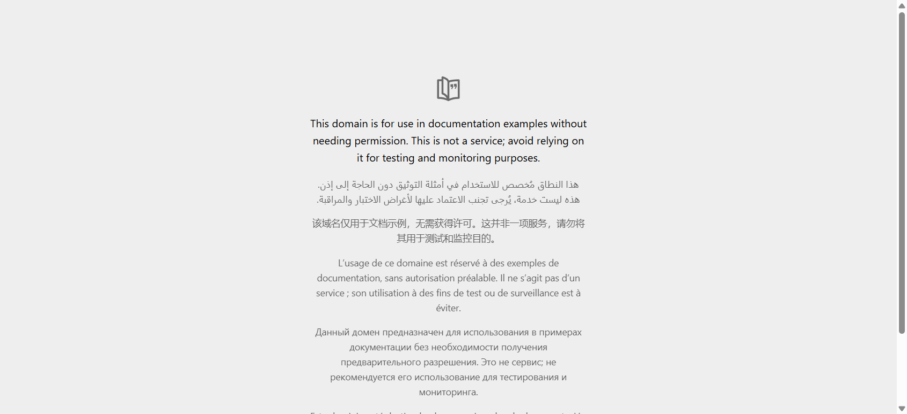
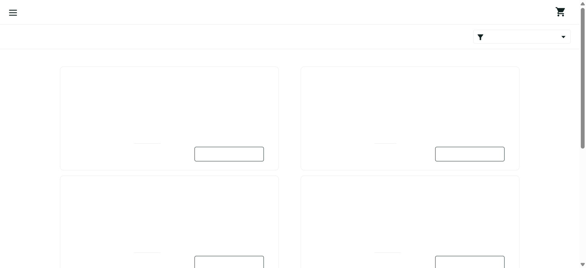
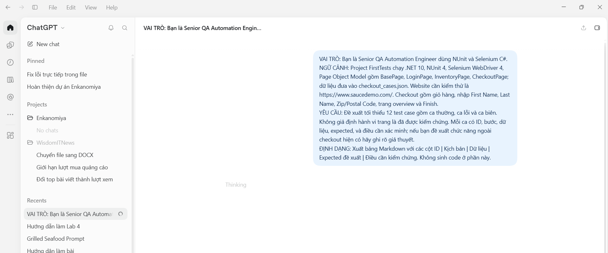
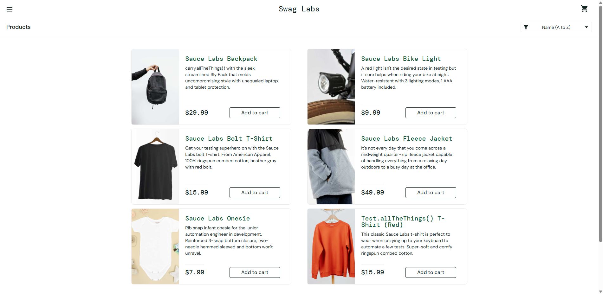
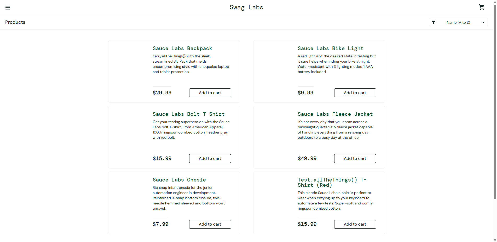

# SOF3091 – KIỂM THỬ NÂNG CAO CÙNG AI – README TỔNG HỢP LAB 1 ĐẾN LAB 7

| | |
|---|---|
| **Họ và tên** | Trần Nguyễn Bình Yên |
| **Mã sinh viên** | TB01913 |
| **Nhóm** | 07 |
| **Môn học** | SOF3091 – Kiểm thử nâng cao cùng AI |
| **Ngày báo cáo** | Lab 1–6: 20/11/2026 · Lab 7: 23/11/2026 |
| **Công nghệ chung** | C#, .NET, NUnit, Selenium WebDriver, Page Object Model |

File này tổng hợp bảy bài Lab trong một nơi: mỗi Lab có mục tiêu, bảng tổng quan các phần của đề, nội dung từng phần, kết quả NUnit và minh chứng. Lab 7 có thêm README riêng (`Lab7/README.md`) với hướng dẫn chạy chi tiết.

## Tổng quan bảy Lab

| Lab | Chủ đề | Website | Kết quả NUnit (Run All) | Báo cáo |
|---|---|---|---|---|
| [1](#lab1) | Môi trường và Selenium đầu tiên | example.com | 1 Passed | `Lab1/TestReport/` |
| [2](#lab2) | Selenium WebDriver cơ bản: locator, đăng nhập, dữ liệu sản phẩm | SauceDemo | 8 Passed | `Lab2/TestReport/` |
| [3](#lab3) | Explicit Wait, dropdown, alert, iframe, screenshot on failure | the-internet, SauceDemo | 7 Passed | `Lab3/TestReport/` |
| [4](#lab4) | Page Object Model, chaining | SauceDemo, the-internet | 16 Passed | `Lab4/TestReport/` |
| [5](#lab5) | Config, DriverFactory, BaseTest, data-driven JSON | SauceDemo | 13 Passed | `Lab5/TestReport/` |
| [6](#lab6) | Category, logging, HTML report, parallel test | SauceDemo | 15 Passed | `Lab6/TestReport/` |
| [7](#lab7) | Dùng AI sinh ca kiểm thử, viết code POM, debug (checkout) | SauceDemo | 19 Passed (+ D01 Failed có chủ đích) | `Lab7/TestReport/` |

## Cách đọc và cách chạy

- **Mỗi Lab là một thư mục độc lập** (`Lab1/` … `Lab7/`) có solution `LabN.slnx`, thư mục `FirstTests/` (mã nguồn), `screenshots/` (ảnh), `TestReport/` (báo cáo). Các đường dẫn ảnh và báo cáo trong README này đã ghi kèm tên thư mục Lab; nếu đặt README ở nơi khác thì cần bỏ hoặc đổi tiền tố `LabN/`.
- **Chạy một Lab:** mở `LabN.slnx` bằng Visual Studio → Test Explorer → Run All; hoặc tại thư mục Lab chạy `dotnet build` rồi `dotnet test`.
- **Báo cáo:** sau mỗi lượt Run, NUnit xuất `TestReport.pdf/.xlsx` (Lab 6–7 có thêm `.html`). Con số "Kết quả NUnit" là số ca được thực thi trong lượt báo cáo đó, không tự chứng minh đã hoàn thành mọi yêu cầu nộp minh chứng của đề.
- **Ca `[Explicit]`** (cố ý Failed để minh họa) không chạy khi Run All; phải chọn riêng trong Test Explorer.

## Tiến trình kiến thức qua các Lab

1. **Lab 1** – dựng môi trường, ca Selenium đầu tiên.
2. **Lab 2** – locator, đăng nhập, đọc dữ liệu.
3. **Lab 3** – xử lý đồng bộ (Explicit Wait), alert, iframe, ảnh khi lỗi.
4. **Lab 4** – tổ chức mã theo Page Object Model.
5. **Lab 5** – tầng cấu hình, DriverFactory, BaseTest, kiểm thử theo dữ liệu JSON.
6. **Lab 6** – Category, logging, báo cáo HTML, chạy song song.
7. **Lab 7** – dùng AI trong cả quy trình: sinh ca, thẩm định, viết code, debug, bắt lỗi của AI.


<a id="lab1"></a>

## LAB 01 – THIẾT LẬP MÔI TRƯỜNG VÀ SELENIUM ĐẦU TIÊN

**Mục tiêu:** Cài đặt môi trường .NET + NUnit + Selenium và chạy ca kiểm thử Selenium đầu tiên.

| Thông tin | Nội dung |
|---|---|
| Thư mục | `Lab1/` |
| Website kiểm thử | https://example.com/ |
| Kết quả NUnit | **1 Passed**, 0 Failed (lượt Run All lúc 19:27, 20/11/2026) |

**Tổng quan các phần**

| Phần | Nội dung | Trọng số | Bài làm | Minh chứng / còn thiếu |
|---|---|---:|---|---|
| A | Thiết lập và kiểm tra môi trường | 30% | Cấu hình, solution, project đã có | Cần ảnh terminal `dotnet --version`, `dotnet --info` |
| B | Kịch bản Selenium đầu tiên | 40% | `OpenPage_ShouldHaveExpectedTitle` Passed | Đủ |
| C | Quản lý mã nguồn với GitHub | 20% | Cấu trúc thư mục, lệnh git, mẫu commit | Cần đối chiếu lịch sử commit và URL trên GitHub |
| D | AI: giải thích lỗi | 10% | Prompt, đề xuất của AI, đối chiếu, nhận xét | Đủ |
| E | Screenshots và Test Report | – | Ảnh B1; `TestReport.pdf/.xlsx` | Đủ |

### A. THIẾT LẬP VÀ KIỂM TRA MÔI TRƯỜNG (30%)

**1. Môi trường sử dụng**

- .NET SDK, Visual Studio/VS Code, Chrome và các gói kiểm thử NUnit, Selenium WebDriver.
- Solution: `Lab1.slnx`; project: `FirstTests/FirstTests.csproj`.
- Tệp cấu hình: `FirstTests/Config/appsettings.json`, có `Browser`, `BaseUrl`, `TimeoutSeconds` và `Headless`.

**2. Kiểm tra phiên bản .NET**

```powershell
dotnet --version
dotnet --info
```

Hai lệnh lần lượt hiển thị phiên bản SDK mặc định và thông tin SDK/runtime, hệ điều hành, kiến trúc máy. Các màn hình này cần được chụp trực tiếp từ terminal khi trình bày phần cài đặt; ảnh trang web do WebDriver chụp không thay thế được ảnh terminal.

**3. Kiểm tra thư viện kiểm thử**

Mở `FirstTests/FirstTests.csproj` để đối chiếu các tham chiếu NUnit, NUnit3TestAdapter, Microsoft.NET.Test.Sdk và Selenium.WebDriver. Project sử dụng `Core/DriverFactory.cs` để tạo trình duyệt, `Core/BaseTest.cs` để quản lý vòng đời test.

### B. KỊCH BẢN SELENIUM ĐẦU TIÊN (40%)

**Ca kiểm thử:** `FirstSeleniumTest.OpenPage_ShouldHaveExpectedTitle` (`FirstTests/FirstSeleniumTest.cs`).

1. Mở Chrome thông qua lớp `DriverFactory` và `BaseTest`.
2. Truy cập `https://example.com/`.
3. Chờ trang tải xong, đọc `driver.Title` và in ra NUnit Test Output.
4. Kiểm tra tiêu đề bằng `Assert.That(title, Is.EqualTo("Example Domain"))`.
5. Kiểm tra URL bắt đầu bằng địa chỉ mong đợi.
6. Đóng trình duyệt tại `[TearDown]` qua `Quit()` và `Dispose()`.

**Kết quả mong đợi:** Tiêu đề là `Example Domain`, URL hợp lệ và ca kiểm thử Passed.  
**Kết quả từ báo cáo:** `OpenPage_ShouldHaveExpectedTitle` — **Passed** (6,598 giây).

**Ảnh minh chứng:** [B1 – Mở trang và kiểm tra tiêu đề](Lab1/screenshots/B1_LAB1_MoTrangKiemTraTieuDe_FirstTests_FirstSeleniumTest_Passed_20261120_192707_414_992ec2.png).



### C. QUẢN LÝ MÃ NGUỒN VỚI GITHUB (20%)

**Cấu trúc thư mục chính:**

```text
Lab1/
├── DeBai.pdf
├── Lab1.slnx
├── README.md
├── FirstTests/
│   ├── FirstSeleniumTest.cs
│   ├── Core/
│   ├── Config/
│   ├── Utilities/
│   └── FirstTests.csproj
├── screenshots/
└── TestReport/
```

File `.gitignore` được đặt tại `FirstTests/.gitignore`. Các bước đưa mã nguồn lên GitHub:

```bash
git init
git add .
git commit -m "chore: khoi tao project selenium nunit"
git commit -m "test: kiem tra tieu de trang example"
git push -u origin main
```

Các thông điệp commit trên là định dạng phù hợp để sử dụng khi thực hiện; lịch sử commit và URL repository cần đối chiếu trực tiếp trên GitHub.

### D. AI INTEGRATION – GIẢI THÍCH LỖI (10%)

**1. Tình huống phân tích**

Khi tạo project NUnit và chạy bài Selenium đầu tiên, cần xử lý trường hợp Chrome không khởi động hoặc driver không tương thích với trình duyệt.

**2. Prompt sử dụng AI**

> Tôi sử dụng Selenium WebDriver với C# và NUnit trên .NET. Khi chạy test bằng Chrome, trình duyệt không khởi động hoặc xảy ra lỗi WebDriverException. Hãy giải thích các nguyên nhân có thể gặp, cách kiểm tra phiên bản Chrome, gói Selenium.WebDriver và cách đóng driver trong TearDown. Ưu tiên hướng khắc phục không làm thay đổi logic Assert.

**3. Nội dung AI đề xuất**

- Kiểm tra Chrome đã được cài đặt và có thể khởi chạy bình thường.
- Kiểm tra phiên bản Selenium.WebDriver và cơ chế quản lý ChromeDriver trong môi trường đang dùng.
- Tách việc tạo trình duyệt vào `DriverFactory`, trả về `IWebDriver` thay vì phụ thuộc trực tiếp một trình duyệt.
- Dùng `[SetUp]` để khởi tạo và `[TearDown]` kết hợp `Quit()` và `Dispose()` để tránh tiến trình Chrome tồn tại sau kiểm thử.
- Nếu lỗi xảy ra trong SetUp, vẫn cần dọn dẹp driver đã tạo một phần.

**4. Đối chiếu với mã nguồn**

Project hiện có `Core/DriverFactory.cs` và `Core/BaseTest.cs`. `BaseTest` đóng driver trong khối `finally`, vì vậy tránh bỏ sót thao tác dọn dẹp khi phần ghi nhận ảnh hoặc kết quả xảy ra ngoại lệ.

**5. Nhận xét**

AI giúp tôi xác định các nhóm nguyên nhân liên quan đến trình duyệt, driver và vòng đời NUnit. Các bước kiểm tra có thứ tự nên dễ tìm lỗi hơn so với việc sửa nhiều phần cùng lúc. Tuy nhiên, AI không thể kết luận phiên bản Chrome của máy bị sai nếu chưa có thông báo lỗi thực tế. Tôi sử dụng gợi ý về `IWebDriver`, `Quit()` và `Dispose()`, đồng thời dựa vào kết quả NUnit để kiểm tra lại.

### E. SCREENSHOTS VÀ TEST REPORT

- [Ảnh B1 – Passed](Lab1/screenshots/B1_LAB1_MoTrangKiemTraTieuDe_FirstTests_FirstSeleniumTest_Passed_20261120_192707_414_992ec2.png).
- [Báo cáo PDF](Lab1/TestReport/TestReport.pdf) · [Báo cáo Excel](Lab1/TestReport/TestReport.xlsx).
- **Tổng kết lượt chạy:** 1 Passed / 0 Failed, lớp `FirstTests.FirstSeleniumTest`.
- Ảnh `dotnet --version`, `dotnet --info`, `.csproj` và lịch sử GitHub là bằng chứng thực hiện ngoài trình duyệt, cần có khi nộp những mục tương ứng.

---

<a id="lab2"></a>

## LAB 02 – SELENIUM WEBDRIVER CƠ BẢN

**Mục tiêu:** Phân tích locator, viết kịch bản đăng nhập thuận/nghịch và thu thập dữ liệu sản phẩm trên SauceDemo.

| Thông tin | Nội dung |
|---|---|
| Thư mục | `Lab2/` |
| Website kiểm thử | https://www.saucedemo.com/ |
| Kết quả NUnit | **8 Passed**, 0 Failed (lượt Run All lúc 19:34, 20/11/2026) |

**Tổng quan các phần**

| Phần | Nội dung | Trọng số | Bài làm | Minh chứng / còn thiếu |
|---|---|---:|---|---|
| A | Phân tích locator (5 phần tử) | 20% | 5 ca A01–A05 Passed | Có ảnh Selenium; ảnh DevTools `1 of 1` thực hiện riêng |
| B | Đăng nhập thuận và nghịch | 30% | `Login_Success`, `Login_LockedOutUser` Passed | Đủ |
| C | Thu thập dữ liệu sản phẩm | 25% | `GetProductInformation` Passed (6 sản phẩm) | Đủ |
| D | AI: locator cho nút Add to cart | 10% | Prompt, 2 locator, locator được chọn, nhận xét | Đủ |
| E | Quản lý mã nguồn và báo cáo | 15% | 3 commit mẫu; `TestReport` 8 Passed | Cần đối chiếu lịch sử GitHub |

### A. LOCATOR ANALYSIS (20%)

Chọn năm phần tử trên SauceDemo. Với tên và giá sản phẩm, locator Selenium được giới hạn vào riêng sản phẩm **Sauce Labs Backpack** để chỉ khớp một phần tử.

| STT | Phần tử | Locator 1 | Locator 2 | Locator được chọn | Lý do |
|---|---|---|---|---|---|
| 1 | Username | `By.Id("user-name")` | `By.Name("user-name")` | `By.Id("user-name")` | ID xác định trực tiếp ô tài khoản, dễ đọc. |
| 2 | Password | `By.Id("password")` | `By.Name("password")` | `By.Id("password")` | ID rõ ràng, ngắn và phù hợp dùng trong thao tác đăng nhập. |
| 3 | Login Button | `By.Id("login-button")` | `By.CssSelector("[data-test='login-button']")` | `By.Id("login-button")` | Chỉ rõ nút đăng nhập, tránh locator theo vị trí. |
| 4 | Product Name (Backpack) | `By.CssSelector("#item_4_title_link [data-test='inventory-item-name']")` | `By.CssSelector("#item_4_title_link .inventory_item_name")` | Locator 1 | Giới hạn vào một sản phẩm để không khớp cả sáu tên. |
| 5 | Product Price (Backpack) | `By.CssSelector("div.inventory_item:has(#item_4_title_link) [data-test='inventory-item-price']")` | `By.CssSelector("div.inventory_item:has(#item_4_title_link) .inventory_item_price")` | Locator 1 | Chỉ lấy giá cùng thẻ sản phẩm Backpack. |

**Kiểm tra bằng Selenium:** `Lab2_LocatorTests.cs` gọi `FindElements(locator)` và Assert `Count == 1` cùng điều kiện `Displayed == true`; cả năm ca A01–A05 đều **Passed** trong báo cáo. **Kiểm tra bằng DevTools:** dán selector CSS (`#user-name`, `#password`, `#login-button`, `#item_4_title_link [data-test='inventory-item-name']`, `div.inventory_item:has(#item_4_title_link) [data-test='inventory-item-price']`) vào ô tìm kiếm Elements bằng `Ctrl + F`; với selector đúng phạm vi, mục tiêu là `1 of 1`. Ảnh do Selenium tự lưu dưới đây minh chứng các ca test, không phải ảnh giao diện DevTools.

#### SCREENSHOTS – LOCATOR VERIFICATION

- [A1 – Username](Lab2/screenshots/A1_LAB2_LocatorUsername_FirstTests_Lab2_LocatorTests_Passed_20261120_193405_035_f87854.png)
- [A2 – Password](Lab2/screenshots/A2_LAB2_LocatorPassword_FirstTests_Lab2_LocatorTests_Passed_20261120_193409_177_19f0d7.png)
- [A3 – Login Button](Lab2/screenshots/A3_LAB2_LocatorNutLogin_FirstTests_Lab2_LocatorTests_Passed_20261120_193412_503_468da8.png)
- [A4 – Product Name](Lab2/screenshots/A4_LAB2_LocatorTenSanPham_FirstTests_Lab2_LocatorTests_Passed_20261120_193416_170_7092e0.png)
- [A5 – Product Price](Lab2/screenshots/A5_LAB2_LocatorGiaSanPham_FirstTests_Lab2_LocatorTests_Passed_20261120_193419_361_5f4455.png)



### B. LOGIN TESTS – LUỒNG THUẬN VÀ NGHỊCH (30%)

**Ca 1 – `Login_Success`**

- Dữ liệu: `standard_user` / `secret_sauce`.
- Các bước: nhập tài khoản, mật khẩu và nhấn Login.
- Mong đợi: URL chứa `inventory.html`.
- Kết quả báo cáo: **Passed**.
- Ảnh: [B1 – Đăng nhập thành công](Lab2/screenshots/B1_LAB2_DangNhapThanhCong_FirstTests_LoginTests_Passed_20261120_193429_441_96287e.png).

**Ca 2 – `Login_LockedOutUser`**

- Dữ liệu: `locked_out_user` / `secret_sauce`.
- Mong đợi: ở lại màn hình đăng nhập, lỗi hiển thị đúng nội dung `Epic sadface: Sorry, this user has been locked out.`.
- Kiểm tra: `errorMessage.Displayed`, nội dung thông báo và URL không chứa `inventory.html`.
- Kết quả báo cáo: **Passed** vì ứng dụng từ chối tài khoản bị khóa đúng như kỳ vọng.
- Ảnh: [B2 – Tài khoản bị khóa](Lab2/screenshots/B2_LAB2_DangNhapTaiKhoanBiKhoa_FirstTests_LoginTests_Passed_20261120_193426_279_c81787.png).

`LoginTests` kế thừa `Core/BaseTest`, nên NUnit thực hiện `[SetUp]`/`[TearDown]` ở lớp cha; mã nguồn có `driver.Quit()` và `driver.Dispose()` để đóng trình duyệt.

### C. PRODUCT DATA – THU THẬP SẢN PHẨM (25%)

**Ca kiểm thử:** `LoginTests.GetProductInformation`.

1. Đăng nhập tài khoản hợp lệ.
2. Dùng `driver.FindElements(By.CssSelector("[data-test='inventory-item']"))` lấy các thẻ sản phẩm.
3. Với mỗi `item`, dùng `item.FindElement(...)` để lấy tên và giá bên trong chính thẻ đó.
4. In danh sách sản phẩm theo dạng `STT. Tên sản phẩm - $Giá`.
5. Assert đủ **6 sản phẩm**, tên không rỗng, mọi giá bắt đầu bằng `$` và danh sách có **Sauce Labs Backpack**.

**Kết quả báo cáo:** `GetProductInformation` — **Passed**.  
**Ảnh:** [C1 – Thu thập sản phẩm](Lab2/screenshots/C1_LAB2_DocSauSanPham_FirstTests_LoginTests_Passed_20261120_193422_458_1b136d.png).

### D. AI INTEGRATION – LOCATOR CHO NÚT ADD TO CART (10%)

**1. Element được chọn:** Nút `Add to cart` của `Sauce Labs Backpack`.

**2. Đoạn HTML dùng để phân tích**

```html
<button id="add-to-cart-sauce-labs-backpack"
        data-test="add-to-cart-sauce-labs-backpack"
        class="btn btn_primary btn_small btn_inventory">
  Add to cart
</button>
```

**3. Prompt sử dụng AI**

> Dựa trên outerHTML nút Add to cart của Sauce Labs Backpack ở SauceDemo, hãy đề xuất hai locator Selenium C#. Ưu tiên ID hoặc data-test; không sử dụng XPath theo vị trí hay chỉ dựa vào tên class. Chọn một locator ổn định hơn và giải thích lý do.

**4. Kết quả AI đề xuất**

- Locator 1: `By.Id("add-to-cart-sauce-labs-backpack")`.
- Locator 2: `By.CssSelector("[data-test='add-to-cart-sauce-labs-backpack']")`.
- **Locator được chọn:** `By.Id("add-to-cart-sauce-labs-backpack")` do ID định danh trực tiếp nút của sản phẩm; `data-test` là phương án thay thế phù hợp khi giao diện thay đổi CSS.

**5. Kiểm tra locator**

Trong DevTools → Elements → `Ctrl + F`, nhập `#add-to-cart-sauce-labs-backpack` hoặc `[data-test='add-to-cart-sauce-labs-backpack']`; một phần tử phù hợp sẽ hiển thị **1 of 1**. Đối chiếu tiếp bằng `driver.FindElements(...)` để xác minh số phần tử khớp.

**6. Nhận xét**

AI đề xuất hai locator dựa vào thuộc tính nhận diện thay vì thứ tự phần tử trên trang. ID ngắn gọn và thuận tiện cho Selenium, trong khi `data-test` cũng phù hợp cho kiểm thử tự động. Tôi không chọn locator theo class vì nhiều nút Add to cart có thể dùng chung class. Việc kiểm tra lại số phần tử khớp giúp tránh chọn nhầm nút của sản phẩm khác.

### E. QUẢN LÝ MÃ NGUỒN VÀ BÁO CÁO (15%)

**Ví dụ ba commit theo Conventional Commits:**

```text
test: them 5 ca kiem tra locator
test: bo sung dang nhap thuan va nghich
docs: cap nhat readme va minh chung lab 2
```

Tiếp tục dùng repository của Lab 1 khi push; kiểm tra số commit và lịch sử trên GitHub.  
**Báo cáo:** [TestReport.pdf](Lab2/TestReport/TestReport.pdf) · [TestReport.xlsx](Lab2/TestReport/TestReport.xlsx).  
**Tổng kết lượt chạy:** 8 Passed / 0 Failed, gồm 5 locator, 2 đăng nhập và 1 thu thập sản phẩm.

---

<a id="lab3"></a>

## LAB 03 – ĐỒNG BỘ, DROPDOWN, ALERT VÀ IFRAME

**Mục tiêu:** Dùng Explicit Wait xử lý đồng bộ, thao tác dropdown/alert/iframe, chụp ảnh khi test lỗi và dùng AI chẩn đoán test không ổn định.

| Thông tin | Nội dung |
|---|---|
| Thư mục | `Lab3/` |
| Website kiểm thử | https://the-internet.herokuapp.com/ và https://www.saucedemo.com/ |
| Kết quả NUnit | **7 Passed**, 0 Failed (chưa tính ca `[Explicit]`) (lượt Run All lúc 19:35, 20/11/2026) |

**Tổng quan các phần**

| Phần | Nội dung | Trọng số | Bài làm | Minh chứng / còn thiếu |
|---|---|---:|---|---|
| A | Explicit Wait | 25% | `A2_PassCoWait` Passed; `A1_RotKhongWait` là `[Explicit]` | Thiếu ảnh A1 rớt với `NoSuchElementException` |
| B | Dropdown và Assert giá tăng dần | 25% | 2 ca sắp xếp giá Passed | Đủ |
| C | JavaScript alert và iframe | 20% | 4 ca C1–C4 Passed | Đủ |
| D | Screenshot on failure | 15% | `D1_CoYRot` (`[Explicit]`); `BaseTest` chụp ảnh | Cần chỉnh để chỉ chụp khi Failed; chưa có ảnh D1 |
| E | AI: chẩn đoán flaky test | 15% | Prompt, 3 gợi ý, đánh giá từng gợi ý | Đủ |

### A. EXPLICIT WAIT – VẤN ĐỀ ĐỒNG BỘ (25%)

**Website:** https://the-internet.herokuapp.com/dynamic_loading/2  
**Tệp mã nguồn:** `FirstTests/PhanA_Lab03.cs`.

**1. Ca không có Wait – `A1_RotKhongWait`**

- Nhấn Start rồi gọi ngay `driver.FindElement(By.Id("finish"))`.
- Nếu JavaScript chưa tạo `#finish`, Selenium ném `NoSuchElementException`.
- Ca này gắn `[Explicit]` nên phải chạy riêng để chụp minh chứng Failed; nó không nằm trong 7 ca Passed của báo cáo hiện tại.

**2. Ca có Wait – `A2_PassCoWait`**

```csharp
driver.FindElement(By.CssSelector("#start button")).Click();
IWebElement finish = wait.Until(d => d.FindElement(By.Id("finish")));
Assert.That(finish.Text, Is.EqualTo("Hello World!"));
```

- **Kết quả báo cáo:** `A2_PassCoWait` — **Passed**.
- **Ảnh:** [A2 – Có Explicit Wait](Lab3/screenshots/A2_LAB3_CoExplicitWait_FirstTests_PhanA_Lab03_Passed_20261120_193535_434_a2311f.png).

**Giải thích:** Với ca không Wait, câu lệnh tìm phần tử có thể chạy khi nội dung vẫn chưa xuất hiện. `WebDriverWait` chờ đến lúc điều kiện tìm được `#finish` mới thực hiện Assert. Chờ theo điều kiện ổn định hơn việc đặt số giây cố định bằng `Thread.Sleep`.

### B. DROPDOWN VÀ ASSERT GIÁ TĂNG DẦN (25%)

**Website:** https://www.saucedemo.com/  
**Tệp:** `PhanB_Lab03.cs`, `SortTests.cs`.

1. Đăng nhập `standard_user` / `secret_sauce`.
2. Tìm dropdown `.product_sort_container` và dùng `SelectElement.SelectByText("Price (low to high)")`.
3. Dùng `FindElements` lấy sáu giá `.inventory_item_price`.
4. Bỏ ký tự `$`, phân tích chuỗi thành `decimal` theo `InvariantCulture`.
5. So sánh danh sách giá thực tế với bản đã `OrderBy(...)` hoặc `Sort()`.

```csharp
var expected = prices.OrderBy(p => p).ToList();
Assert.That(prices, Is.EqualTo(expected));
```

**Kết quả:** `B1_GiaTangDan` và `B1_SapXepPriceLowToHigh_GiaTangDan` — **Passed**.  
**Ảnh:** [B1 – Sắp xếp giá](Lab3/screenshots/B1_LAB3_SapXepGia_FirstTests_PhanB_Lab03_Passed_20261120_193539_510_ff6f72.png) và [B1 – Kiểm tra giá tăng dần](Lab3/screenshots/B1_LAB3_SapXepGiaTangDan_FirstTests_SortTests_Passed_20261120_193616_709_6e5502.png).

### C. JAVASCRIPT ALERT VÀ IFRAME (20%)

**Website:** https://the-internet.herokuapp.com/javascript_alerts và https://the-internet.herokuapp.com/iframe.

| Ca | Hành động Selenium | Kết quả cần Assert | Kết quả báo cáo |
|---|---|---|---|
| `C1_Alert_Accept` | `SwitchTo().Alert().Accept()` | `You successfully clicked an alert` | Passed |
| `C2_Confirm_Dismiss` | `SwitchTo().Alert().Dismiss()` | `You clicked: Cancel` | Passed |
| `C3_Prompt_SendKeys_Accept` | Nhập `Yen test Selenium`, sau đó Accept | `You entered: Yen test Selenium` | Passed |
| `C4_Iframe_GoChu` | `SwitchTo().Frame("mce_0_ifr")`, nhập văn bản và `DefaultContent()` | Nội dung là `Xin chao iframe tu Selenium`; tiêu đề ngoài frame có `iFrame` | Passed |

**Ảnh minh chứng:**

- [C1 – Alert](Lab3/screenshots/C1_LAB3_C1_Alert_Accept_FirstTests_PhanC_Lab03_Passed_20261120_193546_541_a2a6c7.png)
- [C2 – Confirm](Lab3/screenshots/C2_LAB3_C2_Confirm_Dismiss_FirstTests_PhanC_Lab03_Passed_20261120_193556_250_570c3b.png)
- [C3 – Prompt](Lab3/screenshots/C3_LAB3_C3_Prompt_SendKeys_Accept_FirstTests_PhanC_Lab03_Passed_20261120_193602_844_b64759.png)
- [C4 – iFrame](Lab3/screenshots/C4_LAB3_C4_Iframe_GoChu_FirstTests_PhanC_Lab03_Passed_20261120_193611_797_b4853b.png)

### D. SCREENSHOT ON FAILURE (15%)

- Ca `PhanD_Lab03.D1_CoYRot` chứa một Assert tiêu đề cố ý không đúng và được đánh dấu `[Explicit]`.
- Yêu cầu nghiệp vụ là chụp ảnh khi `Outcome.Status == TestStatus.Failed`, đặt tên theo tên ca test và thêm `TestContext.AddTestAttachment(path)`.
- Trong source được nộp, thao tác chụp ảnh và đính kèm được thực hiện tại `Core/BaseTest.cs` thông qua `ScreenshotHelper`; lớp này hiện chụp cho **mọi ca có driver**, không chỉ Failed. Vì vậy, để hoàn toàn đúng yêu cầu *chỉ chụp khi Failed* cần bổ sung điều kiện kiểm tra Outcome cho phần chụp ảnh.
- ZIP minh chứng cung cấp hiện tại có ảnh các ca Passed, chưa có ảnh chạy riêng `D1_CoYRot`.

### E. AI INTEGRATION – CHẨN ĐOÁN FLAKY TEST (15%)

**1. Tình huống:** `#finish` chỉ được JavaScript tạo ra sau khi nhấn Start nên việc tìm ngay lập tức có thể thất bại.

**2. Prompt sử dụng AI**

> Tôi kiểm thử trang https://the-internet.herokuapp.com/dynamic_loading/2 bằng C#, NUnit và Selenium. Sau khi click `#start button`, code gọi `driver.FindElement(By.Id("finish"))` ngay lập tức. Test có thể xuất hiện lỗi `OpenQA.Selenium.NoSuchElementException: no such element` vì nội dung tải động. Hãy phân tích nguyên nhân, đề xuất 3 cách xử lý và cho biết cách nào nên sử dụng. Không thay nghiệp vụ Assert `Hello World!`.

**3. AI đề xuất**

- **Gợi ý 1:** Dùng `WebDriverWait.Until(...)` để chờ phần tử `#finish` xuất hiện trước khi đọc text.
- **Gợi ý 2:** Dùng `Thread.Sleep(5000)` để cho trang thêm thời gian tải.
- **Gợi ý 3:** Chuyển sang tài khoản `performance_glitch_user` để tạo môi trường tải chậm.

**4. Đánh giá các gợi ý**

| Gợi ý | Đánh giá | Lý do |
|---|---|---|
| Explicit Wait | Phù hợp | Chờ đúng phần tử được tạo ra sau thao tác Start. |
| Thread.Sleep | Không lựa chọn | Chờ cố định gây chậm và có thể vẫn không đủ trên máy chậm. |
| performance_glitch_user | Không phù hợp | Đây là tài khoản SauceDemo, không liên quan trực tiếp tới JavaScript tạo `#finish` của trang đang kiểm thử. |

**5. Nhận xét**

AI xác định đúng vấn đề chính là thứ tự thực thi và việc phần tử được tạo bất đồng bộ. Phương án Explicit Wait phù hợp nhất vì có thể kiểm chứng bằng ca `A2_PassCoWait`. Gợi ý dùng Sleep đơn giản nhưng không giải quyết ổn định khi thời gian phản hồi thay đổi. Gợi ý thay tài khoản SauceDemo không liên quan đến trang Dynamic Loading nên tôi loại bỏ.

### F. TEST REPORT

**Tổng kết lượt chạy:** 7 Passed / 0 Failed; chưa tính các test `[Explicit]` chỉ chạy khi được chọn riêng.  
**Báo cáo:** [PDF](Lab3/TestReport/TestReport.pdf) · [Excel](Lab3/TestReport/TestReport.xlsx).  
**Bằng chứng thiếu để hoàn tất Phần A/D:** ảnh test không Wait rớt với `NoSuchElementException`; ảnh test cố ý Failed và kiểm tra cơ chế chụp chỉ khi Failed.

---

<a id="lab4"></a>

## LAB 04 – PAGE OBJECT MODEL VÀ REFACTOR TEST

**Mục tiêu:** Đưa các test Lab 2–3 về mô hình Page Object, dùng BasePage và chaining.

| Thông tin | Nội dung |
|---|---|
| Thư mục | `Lab4/` |
| Website kiểm thử | https://www.saucedemo.com/ và https://the-internet.herokuapp.com/ |
| Kết quả NUnit | **16 Passed**, 0 Failed (lượt Run All lúc 19:39, 20/11/2026) |

**Tổng quan các phần**

| Phần | Nội dung | Trọng số | Bài làm | Minh chứng / còn thiếu |
|---|---|---:|---|---|
| A | Cấu trúc POM và BasePage | 20% | `Pages_Lab04/`, `Tests_Lab04/` | Đủ |
| B | LoginPage và InventoryPage | 25% | Bảng hành vi công khai của từng Page | Đủ |
| C | Refactor test Lab 2–3 sang POM | 30% | 16 ca Passed; ảnh C1–C5 | Cần đối chiếu trước/sau refactor với kết quả Lab 2–3 |
| D | Chaining và Assert giá tăng dần | 15% | `SortTests_Lab04` Passed | Đủ |
| E | AI: thẩm định code POM | 10% | Phát hiện `GetLoginButton()` trả `IWebElement` | Đủ |

### A. CẤU TRÚC PAGE OBJECT MODEL VÀ BASEPAGE (20%)

**Cấu trúc đang dùng:** `FirstTests/Pages_Lab04/` và `FirstTests/Tests_Lab04/` (có hậu tố `_Lab04` để tách biệt với các Lab khác).

```text
FirstTests/
├── Pages_Lab04/
│   ├── BasePage.cs
│   ├── LoginPage.cs
│   ├── InventoryPage.cs
│   ├── DynamicLoadingPage.cs
│   ├── JavaScriptAlertsPage.cs
│   ├── IframePage.cs
│   └── HerokuHomePage.cs
└── Tests_Lab04/
    ├── TestBase.cs
    ├── LoginTests_Lab04.cs
    ├── SortTests_Lab04.cs
    └── [các lớp kiểm thử được chuyển từ Lab 2–3]
```

- `BasePage` là `abstract`, giữ `protected readonly IWebDriver driver` và `protected readonly WebDriverWait wait`.
- Hàm `protected IWebElement Tim(By locator)` bao bọc việc chờ và tìm phần tử, dùng nội bộ cho lớp Page kế thừa.
- Page Object chứa locator; lớp test gọi hành vi công khai và thực hiện Assert.

### B. LOGINPAGE & INVENTORYPAGE (25%)

| Page | Hành vi công khai | Ý nghĩa |
|---|---|---|
| `LoginPage` | `MoTrang()`, `DangNhap(tk, mk)`, `LayThongBaoLoi()` | Truy cập trang đăng nhập, gửi thông tin và đọc lỗi. |
| `InventoryPage` | `DaHienThi()`, `SapXep(value)`, `LayDanhSachGia()` | Kiểm tra trang sản phẩm, sắp xếp và lấy giá. |
| `InventoryPage` | `ChoDanhSachSanPham()`, `LayDanhSachSanPham()` | Chờ và lấy danh sách sản phẩm. |
| `JavaScriptAlertsPage` | `MoAlert()`, `MoConfirm()`, `MoPrompt()`, `ChapNhan()`, `Huy()` | Đóng gói thao tác với JS Alert. |
| `IframePage` | `VaoIframe()`, `GhiNoiDung()`, `ThoatIframe()` | Đóng gói thao tác iframe. |

`LoginPage` chứa các trường locator `private readonly By`. Các Page không đặt Assert bên trong và trả dữ liệu/hành vi cho lớp test thay vì công khai `IWebElement`.

### C. REFACTOR TEST LAB 2–3 SANG POM (30%)

**Nguyên tắc:** File test không tự tìm phần tử bằng `By`; locator được chuyển vào lớp Page. `Tests_Lab04` chứa các kịch bản đăng nhập thành công, tài khoản bị khóa, đọc sản phẩm, Dynamic Loading, Alert, iFrame và sắp xếp giá.

**Ví dụ luồng đăng nhập:**

```csharp
LoginPage login = new LoginPage(driver).MoTrang();
InventoryPage inventory = login.DangNhap("standard_user", "secret_sauce");
Assert.That(inventory.LayDuongDan(), Does.Contain("inventory.html"));
```

**Kết quả từ report:** 16 ca **Passed**, gồm các nhóm login, product, wait, alert/iframe và sort. Báo cáo hiện tại là lượt chạy sau POM; để so sánh *trước/sau refactor* theo đúng yêu cầu cần sử dụng kết quả Lab 2/3 làm mốc và đối chiếu các kịch bản tương ứng (không so sánh máy móc tổng số ca do phạm vi khác nhau).

**Ảnh minh chứng:**

- [C1 – Đăng nhập sau POM](Lab4/screenshots/C1_LAB4_DangNhapSauPOM_FirstTests_Tests_Lab04_LoginTests_Lab04_Passed_20261120_194010_042_25c7c3.png)
- [C2 – Đăng nhập lỗi sau POM](Lab4/screenshots/C2_LAB4_DangNhapLoiSauPOM_FirstTests_Tests_Lab04_LoginTests_Lab04_Passed_20261120_194006_807_e11fbf.png)
- [C3 – Đọc sản phẩm](Lab4/screenshots/C3_LAB4_DocSanPhamSauPOM_FirstTests_Tests_Lab04_LoginTests_Lab04_Passed_20261120_194002_650_c817ff.png)
- [C5 – Explicit Wait qua Page](Lab4/screenshots/C5_LAB4_TestDynamicPOM_FirstTests_Tests_Lab04_PhanA_Lab03_Lab04_Passed_20261120_194033_769_5479be.png)
- [C4 – iFrame qua Page](Lab4/screenshots/C_LAB4_C4_Iframe_GoChu_FirstTests_Tests_Lab04_PhanC_Lab03_Lab04_Passed_20261120_194112_271_6f3547.png)

### D. CHAINING VÀ ASSERT SORT GIÁ TĂNG DẦN (15%)

File `Tests_Lab04/SortTests_Lab04.cs` gọi nối chuỗi:

```csharp
List<decimal> prices = login
    .DangNhap("standard_user", "secret_sauce")
    .SapXep("lohi")
    .LayDanhSachGia();
Assert.That(prices.Count, Is.EqualTo(6));
Assert.That(prices, Is.Ordered.Ascending);
```

`SapXep("lohi")` trả về `this` ở `InventoryPage`, cho phép nối tiếp với `LayDanhSachGia()`; điều kiện `Is.Ordered.Ascending` kiểm tra trực tiếp thứ tự giá.

**Ảnh:** [D1 – Sắp xếp giá qua POM](Lab4/screenshots/D1_LAB4_SapXepGiaBangPOM_FirstTests_Tests_Lab04_PhanB_Lab03_Lab04_Passed_20261120_194038_196_d1a984.png) và [D2 – Chaining giá tăng dần](Lab4/screenshots/D2_LAB4_ChainingGiaTangDan_FirstTests_Tests_Lab04_SortTests_Lab04_Passed_20261120_194117_369_11f648.png).

### E. AI INTEGRATION – THẨM ĐỊNH CODE POM (10%)

**1. File lựa chọn:** Chuyển thao tác Login từ Selenium trực tiếp sang `LoginPage`.

**2. Prompt sử dụng AI**

> Hãy refactor test đăng nhập SauceDemo bằng C# NUnit Selenium sang Page Object Model. Yêu cầu `BasePage` giữ IWebDriver và WebDriverWait; locator đặt `private readonly By`; Page chỉ cung cấp hành vi nghiệp vụ, không có Assert và không trả `IWebElement` ra lớp test. `LoginPage.DangNhap(tk, mk)` phải trả `InventoryPage`, còn Assert nằm trong test.

**3. Kết quả AI đề xuất (đoạn cần thẩm định)**

```csharp
public IWebElement GetLoginButton()
{
    return driver.FindElement(By.Id("login-button"));
}
```

Đồng thời AI gợi ý test gọi `GetLoginButton().Click()` và kiểm tra URL sau thao tác.

**4. Điểm chưa đúng:** `GetLoginButton()` trả `IWebElement` ra ngoài Page Object và làm file test phụ thuộc cấu trúc HTML; điều này trái quy ước POM của bài. Phương án phù hợp là giữ locator `private readonly By nutDangNhap` và cho `DangNhap(...)` tự thao tác click, sau đó trả `InventoryPage`.

**5. Cách thể hiện trong mã nguồn**

```csharp
private readonly By nutDangNhap = By.Id("login-button");
public InventoryPage DangNhap(string tk, string mk)
{
    Tim(oTaiKhoan).SendKeys(tk);
    Tim(oMatKhau).SendKeys(mk);
    Tim(nutDangNhap).Click();
    return new InventoryPage(driver);
}
```

**6. Nhận xét**

AI giúp xác định nên gom các thao tác giao diện vào lớp Page. Tuy nhiên, đoạn trả `IWebElement` khiến test vẫn phụ thuộc trực tiếp vào phần tử HTML. Tôi giữ locator dưới dạng `private readonly By` và chỉ công khai hành vi đăng nhập. Các Assert tiếp tục nằm ở lớp test để lớp Page có thể tái sử dụng.

### F. BÁO CÁO KẾT QUẢ

**TestReport:** 16 Passed / 0 Failed, 7 lớp kiểm thử trong lượt chạy.  
**Tệp:** [PDF](Lab4/TestReport/TestReport.pdf) · [Excel](Lab4/TestReport/TestReport.xlsx).  
**Lưu ý cấu trúc:** Thư mục thật của source là `Pages_Lab04` và `Tests_Lab04`, không phải tên ngắn `Pages`/`Tests` trong ví dụ đề.

---

<a id="lab5"></a>

## LAB 05 – TEST FRAMEWORK VÀ DATA-DRIVEN TESTING

**Mục tiêu:** Xây tầng cấu hình, DriverFactory, BaseTest, ScreenshotHelper và chạy kiểm thử theo dữ liệu JSON.

| Thông tin | Nội dung |
|---|---|
| Thư mục | `Lab5/` |
| Website kiểm thử | https://www.saucedemo.com/ |
| Kết quả NUnit | **13 Passed**, 0 Failed (lượt Run All lúc 19:42, 20/11/2026) |

**Tổng quan các phần**

| Phần | Nội dung | Trọng số | Bài làm | Minh chứng / còn thiếu |
|---|---|---:|---|---|
| A | Configuration layer | 20% | `appsettings.json`, `ConfigReader`, `TestConfig`; 2 ca Passed | Đủ |
| B | DriverFactory | 20% | Chrome/Firefox theo cấu hình; 2 ca Passed | Thiếu cặp ảnh so sánh hai trình duyệt |
| C | BaseTest và ScreenshotHelper | 20% | `C01` Passed; `C02` là `[Explicit]` | Cần chỉnh để chỉ chụp khi Failed |
| D | Data-driven với JSON | 25% | `users.json` 8 bộ; 8 ca Passed | Cần ảnh Test Explorer trước/sau khi thêm 1 bộ dữ liệu |
| E | AI: sinh và thẩm định dữ liệu | 15% | AI đề xuất 10 bộ; phát hiện 2 bộ sai kỳ vọng (bộ 07, 09) | Đủ |

### A. CONFIGURATION LAYER (20%)

**Cấu trúc:** `FirstTests/Config/appsettings.json`, `Config/TestConfig.cs`, `Config/ConfigReader.cs`.

```json
{
  "BaseUrl": "https://www.saucedemo.com/",
  "Browser": "Chrome",
  "TimeoutSeconds": 8,
  "Headless": false,
  "WindowWidth": 1366,
  "WindowHeight": 768
}
```

`ConfigReader` đọc dữ liệu; `TestConfig` chứa giá trị cấu hình; project copy JSON ra output khi chạy. Hai test `A01_DocCauHinhTuJson` và `A02_CauHinhKhongHopLeCoThongBao` đều **Passed**.

**Ảnh:** [A1 – Đọc JSON](Lab5/screenshots/A1_LAB5_DocCauHinhJSON_FirstTests_Tests_LAB05_PhanA_Passed_20261120_194207_417_42f950.png) và [A2 – Cấu hình không hợp lệ](Lab5/screenshots/A2_LAB5_KiemTraConfigKhongHopLe_FirstTests_Tests_LAB05_PhanA_Passed_20261120_194210_896_7f7fae.png).

### B. DRIVER FACTORY (20%)

`Core/DriverFactory.cs` có `Create(TestConfig cfg)` trả `IWebDriver`, tạo `ChromeDriver` hoặc `FirefoxDriver` theo `Browser`. Khi bật `Headless`, code thêm tùy chọn chạy ẩn cho cả hai trình duyệt; giá trị tên trình duyệt không hợp lệ sẽ sinh `NotSupportedException` chứa tên lỗi.

- `B01_CungCode_ChayTheoBrowserTrongJson`: kiểm tra loại driver theo cấu hình — **Passed** với cấu hình trong lượt chạy.
- `B02_TenBrowserSai_ThongBaoRoRang`: kiểm tra thông báo khi dùng `Firefix` — **Passed**.

**Ảnh:** [B1 – Driver Factory](Lab5/screenshots/B1_LAB5_DriverFactory_Chrome_FirstTests_Tests_LAB05_PhanB_Passed_20261120_194213_848_367b93.png) và [B3 – Browser không hợp lệ](Lab5/screenshots/B3_LAB5_XuLyBrowserKhongHopLe_FirstTests_Tests_LAB05_PhanB_Passed_20261120_194217_112_2a99a7.png).  
**Yêu cầu so sánh 2 trình duyệt:** mã nguồn hỗ trợ Chrome/Firefox; ZIP ảnh cung cấp chưa tách một cặp ảnh chứng minh riêng hai lần chạy đổi duy nhất `Browser` trong JSON.

### C. BASETEST & SCREENSHOTHELPER (20%)

`Core/BaseTest.cs` gom `[SetUp]` đọc config, tạo driver, vào BaseUrl; `[TearDown]` chụp ảnh, `Quit()` và `Dispose()` trong `finally`. File `Utilities/ScreenshotHelper.cs` chịu trách nhiệm lưu ảnh và gắn vào kết quả NUnit. Các test phần A–D kế thừa `BaseTest` nên tránh lặp lại thao tác khởi tạo trình duyệt.

- `C01_BaseTest_DaMoDuongDanCauHinh`: **Passed**.
- `C02_CoYFail_DeChupAnh`: được đánh dấu `[Explicit]`, không chạy trong 13 ca của báo cáo.
- Cơ chế chụp hiện tại trong `BaseTest` thực hiện với mọi test có driver, không chỉ test Failed; để đáp ứng đúng điều kiện *chỉ chụp khi Failed* cần xét `TestContext.CurrentContext.Result.Outcome.Status` trước khi gọi Capture.

**Ảnh:** [C1 – SetUp và TearDown](Lab5/screenshots/C1_LAB5_BaseTestSetUpTearDown_FirstTests_Tests_LAB05_PhanC_Passed_20261120_194220_098_4f00ab.png).

### D. DATA-DRIVEN TESTING VỚI JSON (25%)

**Nguồn dữ liệu:** `FirstTests/Data/users.json` gồm **8 bộ dữ liệu**, mỗi bộ có bốn trường `Username`, `Password`, `ThanhCong`, `GhiChu`.

| Ca | Username | Password | ThanhCong | Loại kiểm thử |
|---|---|---|---|---|
| 01 | `standard_user` | `secret_sauce` | true | Luồng thuận |
| 02 | `locked_out_user` | `secret_sauce` | false | Tài khoản bị khóa |
| 03 | *(rỗng)* | `secret_sauce` | false | Giá trị biên: username rỗng |
| 04 | `standard_user` | *(rỗng)* | false | Giá trị biên: password rỗng |
| 05 | `sai_tai_khoan` | `sai_mat_khau` | false | Cả hai giá trị không đúng |
| 06 | `!@#$%^&*` | `secret_sauce` | false | Username có ký tự đặc biệt |
| 07 | `standard_user  ` | `secret_sauce` | false | Username có khoảng trắng cuối |
| 08 | `khong_ton_tai_08` | `secret_sauce` | false | Tài khoản không tồn tại |

**Cách chạy:** `LAB05_PhanD.DuLieuDangNhap()` là phương thức `static` trả `IEnumerable<TestCaseData>`; test dùng `[TestCaseSource(nameof(DuLieuDangNhap))]` và `.SetName(...)`. Mỗi mục JSON tương ứng một ca trong Test Explorer. `InventoryPage.DaHienThi()` trả `false` khi đăng nhập thất bại và không để Timeout làm gián đoạn Assert thông thường.

**Kết quả:** 8 ca Data-Driven đều **Passed** trong lượt báo cáo; ngoài ra 5 ca kiểm tra Config/Factory/BaseTest cũng Passed.  
**Ảnh:** [D1 – Đăng nhập hợp lệ](Lab5/screenshots/D1_LAB5_DangNhapTheoJSON_DangNhap_01_CoDuLieu_ThanhCong_FirstTests_Tests_LAB05_PhanD_Passed_20261120_194223_117_636aea.png) và [D1 – Username rỗng](Lab5/screenshots/D1_LAB5_DangNhapTheoJSON_DangNhap_03_Trong_ThatBai_FirstTests_Tests_LAB05_PhanD_Passed_20261120_194230_859_7b90fa.png).

**Minh chứng tính mở rộng:** để chứng minh JSON tăng thêm 1 bộ mà không sửa `.cs`, cần đối chiếu số test trước/sau khi thêm dữ liệu và chụp Test Explorer ở hai lần. Báo cáo đính kèm chứng nhận lượt đang có 8 bộ.

### E. AI INTEGRATION – SINH VÀ THẨM ĐỊNH DỮ LIỆU (15%)

**1. Prompt sử dụng AI**

> Hãy đề xuất 10 bộ dữ liệu kiểm thử form đăng nhập SauceDemo dùng cho NUnit, Selenium C#. Kết quả trả về đúng JSON array với bốn trường `Username`, `Password`, `ThanhCong`, `GhiChu`. Có luồng hợp lệ, tài khoản khóa, dữ liệu sai và các ca biên như rỗng, khoảng trắng, ký tự đặc biệt. Tôi sẽ đánh giá lại kỳ vọng và tính hợp lệ của từng bộ trước khi đưa vào `users.json`.

**2. Kết quả AI trả về (10 bộ dữ liệu)**

```json
[
  {"Username":"standard_user","Password":"secret_sauce","ThanhCong":true,"GhiChu":"Tai khoan hop le"},
  {"Username":"locked_out_user","Password":"secret_sauce","ThanhCong":false,"GhiChu":"Tai khoan bi khoa"},
  {"Username":"","Password":"secret_sauce","ThanhCong":false,"GhiChu":"Username rong"},
  {"Username":"standard_user","Password":"","ThanhCong":false,"GhiChu":"Password rong"},
  {"Username":"sai_tai_khoan","Password":"sai_mat_khau","ThanhCong":false,"GhiChu":"Thong tin dang nhap sai"},
  {"Username":"!@#$%^&*","Password":"secret_sauce","ThanhCong":false,"GhiChu":"Username co ky tu dac biet"},
  {"Username":"standard_user  ","Password":"secret_sauce","ThanhCong":true,"GhiChu":"Cho phep username co khoang trang cuoi"},
  {"Username":"khong_ton_tai_08","Password":"secret_sauce","ThanhCong":false,"GhiChu":"Tai khoan khong ton tai"},
  {"Username":"locked_out_user","Password":"secret_sauce","ThanhCong":true,"GhiChu":"Tai khoan khoa van dang nhap duoc"},
  {"Username":"standard_user","Password":"sai_mat_khau","ThanhCong":false,"GhiChu":"Dung username, sai password"}
]
```

**3. Thẩm định hai bộ không phù hợp**

- **Bộ 07** đặt `ThanhCong: true` khi Username là `standard_user  ` (có hai khoảng trắng cuối). SauceDemo không mặc nhiên bỏ khoảng trắng cuối; chính file `users.json` hiện tại đã đặt kỳ vọng `false`. Cần sửa `ThanhCong` thành `false` trước khi sử dụng.
- **Bộ 09** đặt `ThanhCong: true` cho `locked_out_user`. Tài khoản này bị khóa và phải báo lỗi; kỳ vọng `true` không phù hợp. Cần sửa thành `false` hoặc loại bộ dữ liệu trùng với bộ 02.

**4. Kết luận**

AI hỗ trợ tạo nhanh dữ liệu đa dạng và đúng tên trường JSON. Tuy nhiên, kỳ vọng `ThanhCong` không thể chấp nhận chỉ vì định dạng hợp lệ. Hai bộ 07 và 09 có dự đoán sai hành vi đăng nhập nên tôi không dùng nguyên trạng. Bộ dữ liệu triển khai thực tế trong `Data/users.json` gồm tám ca với giá trị mong đợi đã được lựa chọn riêng.

### F. TEST REPORT

- **Tổng số:** 13 Passed / 0 Failed; 8 ca từ JSON và 5 ca cấu hình/factory/base test.
- **Báo cáo:** [PDF](Lab5/TestReport/TestReport.pdf) · [Excel](Lab5/TestReport/TestReport.xlsx).

---

<a id="lab6"></a>

## LAB 06 – TEST RUNNER, LOGGING, HTML REPORT VÀ PARALLEL TEST

**Mục tiêu:** Gắn Category để lọc test, ghi log, xuất báo cáo HTML và chạy song song các fixture.

| Thông tin | Nội dung |
|---|---|
| Thư mục | `Lab6/` |
| Website kiểm thử | https://www.saucedemo.com/ |
| Kết quả NUnit | **15 Passed**, 0 Failed (lượt Run All lúc 19:16, 20/11/2026) |

**Tổng quan các phần**

| Phần | Nội dung | Trọng số | Bài làm | Minh chứng / còn thiếu |
|---|---|---:|---|---|
| A | Category | 15% | `LAB06_Smoke`, `LAB06_Login` | Cần ảnh chạy lọc `Category=Smoke`, `Category!=Slow` |
| B | Logging trong BaseTest | 25% | `Log.Info/Error`, tệp `NhatKy_*.log` | Cần ca Failed để có dòng `[ERROR]` |
| C | TRX và báo cáo HTML | 15% | `TestReport.html` 15 Passed | Cần `.trx` và ảnh chuyển TRX → HTML |
| D | Parallel testing | 30% | `Parallelizable(Fixtures)`, 4 luồng; 15 Passed | Cần số đo tuần tự so với song song |
| E | AI: ca kiểm thử và Assert cho Login | 15% | 6 ca AI; loại AI-03 và AI-06 | Đủ |

### A. TỔ CHỨC CA KIỂM THỬ BẰNG CATEGORY (15%)

`FirstTests/Tests/LAB06_CategoryTests.cs` gồm:

- `LAB06_Smoke.A01_TrangDangNhapHienThi`: gắn `[Category("Smoke")]`, kiểm tra tiêu đề `Swag Labs`.
- `LAB06_Login.A02_DangNhapThanhCong`: gắn `[Category("Login")]`, kiểm tra đăng nhập hợp lệ.
- Các fixture Lab 5 kế thừa tiếp tục tham gia chạy theo nhóm; `LAB05_PhanA` cũng có `Smoke`, `LAB05_PhanD` cũng có `Login`.

**Lệnh chạy lọc:**

```bash
dotnet test --filter "Category=Smoke"
dotnet test --filter "Category!=Slow"
```

**Kết quả lượt Run All:** Smoke và Login đều có ca Passed trong báo cáo. Lệnh lọc `Category=Smoke` và `Category!=Slow` cần chạy riêng nếu muốn chứng minh số ca được chọn lọc; tổng report Run All không thay thế ảnh hai lệnh lọc.

**Ảnh:** [A1 – Smoke](Lab6/screenshots/A1_LAB6_Smoke_TrangDangNhap_FirstTests_Tests_LAB06_Smoke_Passed_20261120_191649_941_d97db3.png) và [A2 – Login](Lab6/screenshots/A2_LAB6_Login_DangNhapThanhCong_FirstTests_Tests_LAB06_Login_Passed_20261120_191646_386_59fb0e.png).

### B. LOGGING TRONG BASETEST (25%)

**Tệp:** `FirstTests/Utilities/Log.cs`, `FirstTests/Core/BaseTest.cs`.

- `Log.Info(message)` và `Log.Error(message)` ghi thời gian, mức độ, nội dung vào `TestContext.Progress` và tệp `.log`.
- `[SetUp]` ghi `BẮT ĐẦU: <tên test>`; `[TearDown]` ghi `KẾT QUẢ PASSED...` hoặc `RỚT...` nếu Failed.
- Dùng `lock` khi ghi file để tránh các luồng song song ghi chồng lên nhau.

**Đoạn nhật ký có trong tệp cung cấp:**

```text
[2026-11-20 19:16:29.957 +07:00] [INFO] BẮT ĐẦU: A01_DocCauHinhTuJson
[2026-11-20 19:16:50.033 +07:00] [INFO] KẾT QUẢ PASSED: A01_DocCauHinhTuJson
[2026-11-20 19:16:46.960 +07:00] [INFO] KẾT QUẢ PASSED: A02_DangNhapThanhCong
```

Đường dẫn: [NhatKy_20261120_191629_932.log](Lab6/TestReport/NhatKy_20261120_191629_932.log). Trong lượt chạy được nộp không có ca Failed nên log này chưa chứa dòng `[ERROR]` của một test Failed. Mã nguồn có ca `[Explicit]` `B01_CoYFail_DeChungMinhErrorLog` để chạy riêng nếu cần chứng minh nhánh ERROR.

### C. TRX VÀ BÁO CÁO HTML (15%)

**Báo cáo hiện có:** `TestReport/TestReport.html` ghi **15 Test Cases, 15 Passed, 0 Failed**; các tệp PDF và Excel thống kê cùng lượt Run.

**Xuất TRX khi chạy NUnit:**

```bash
dotnet test --logger "trx;LogFileName=ketqua.trx"
```

TRX là tệp kết quả theo định dạng VSTest, có thể dùng công cụ tương thích để chuyển thành HTML. **Lưu ý:** file HTML hiện tại trong minh chứng được tạo trực tiếp từ kết quả NUnit bởi cơ chế report của project; trong ZIP chưa có `ketqua.trx` hoặc ảnh chứng minh thao tác chuyển đổi từ TRX sang HTML. Vì vậy, cần đối chiếu bước chuyển đổi riêng nếu tiêu chí chấm yêu cầu đúng đường đi TRX → HTML.

**Liên kết báo cáo:** [HTML](Lab6/TestReport/TestReport.html) · [PDF](Lab6/TestReport/TestReport.pdf) · [Excel](Lab6/TestReport/TestReport.xlsx).

### D. PARALLEL TESTING VÀ THREAD-SAFETY (30%)

`FirstTests/AssemblyInfo.cs` đã cấu hình:

```csharp
[assembly: Parallelizable(ParallelScope.Fixtures)]
[assembly: LevelOfParallelism(4)]
```

NUnit có thể chạy tối đa bốn fixture đồng thời; các test bên trong cùng fixture được xử lý theo cấu hình fixture. `BaseTest` dùng `driver` thuộc instance test, không dùng một `static IWebDriver` chung. Khi nhiều fixture chạy song song, driver cần được khởi tạo và dọn dẹp tách biệt, tránh một ca đóng trình duyệt mà ca khác đang sử dụng.

**Đối chiếu:** log có nhiều dòng `BẮT ĐẦU` tại cùng thời điểm `19:16:29.957`, phù hợp với thực thi đồng thời. Báo cáo cung cấp một lượt chạy song song với 15 Passed; chưa có cặp số đo tuần tự/song song trên cùng bộ ca để tính tốc độ tăng và xác nhận kết quả hai chế độ tương đương. Có thể bật `Headless` trong `Config/appsettings.json` khi chạy nhiều browser để giảm tải giao diện.

### E. AI INTEGRATION – TEST CASE VÀ ASSERT CHO LOGIN (15%)

**1. Phần tử lựa chọn:** ô Username của SauceDemo, `By.CssSelector("[data-test='username']")`.

**2. Prompt sử dụng AI**

> Tôi kiểm thử trang đăng nhập SauceDemo bằng NUnit và Selenium C#. Hãy đề xuất ít nhất 5 ca kiểm thử cho trường Username, bao gồm username hợp lệ, rỗng, có khoảng trắng cuối, ký tự đặc biệt và tài khoản bị khóa. Kèm dữ liệu đầu vào, kết quả mong đợi và ví dụ NUnit Assert. Không thay đổi mã nguồn của ứng dụng. Tôi sẽ kiểm tra lại các kỳ vọng theo hành vi SauceDemo.

**3. Kết quả AI đề xuất**

| Ca | Username | Password | Kỳ vọng AI | Ví dụ Assert |
|---|---|---|---|---|
| AI-01 | `standard_user` | `secret_sauce` | Đăng nhập thành công | `Assert.That(inventory.DaHienThi(), Is.True);` |
| AI-02 | *(rỗng)* | `secret_sauce` | Không đăng nhập; báo lỗi | `Assert.That(login.CoThongBaoLoi(), Is.True);` |
| AI-03 | `standard_user  ` | `secret_sauce` | Tự xóa khoảng trắng, đăng nhập thành công | `Assert.That(inventory.DaHienThi(), Is.True);` |
| AI-04 | `!@#$%^&*` | `secret_sauce` | Không đăng nhập; báo lỗi | `Assert.That(inventory.DaHienThi(), Is.False);` |
| AI-05 | `locked_out_user` | `secret_sauce` | Không đăng nhập; thông báo bị khóa | `Assert.That(login.LayThongBaoLoi(), Does.Contain("locked out"));` |
| AI-06 | `standard_user` | *(rỗng)* | Trình duyệt chặn submit trước khi gửi biểu mẫu | `Assert.That(login.CoThongBaoLoi(), Is.False);` |

**4. Hai trường hợp AI đề xuất chưa phù hợp**

- **AI-03:** Dự đoán hệ thống tự loại bỏ hai khoảng trắng cuối là không phù hợp với kỳ vọng thực tế đã dùng trong `Data/users.json` của Lab 5–6. Giá trị phù hợp là `ThanhCong = false`; kiểm tra thông báo lỗi khi đăng nhập.
- **AI-06:** AI giả định trường Password rỗng bị HTML5 chặn trước khi submit. Test data có sẵn tại `users.json` được thiết kế để bấm Login và kiểm tra **thông báo lỗi của SauceDemo**, vì vậy Assert `CoThongBaoLoi() == false` là không phù hợp.

**5. Điều chỉnh Assert**

```csharp
bool dangNhapThanhCong = new LoginPage(driver, config.TimeoutSeconds)
    .DangNhap(username, password)
    .DaHienThi();
Assert.That(dangNhapThanhCong, Is.EqualTo(thanhCong));
```

**6. Nhận xét**

AI hỗ trợ liệt kê các ca biên ngoài luồng đăng nhập hợp lệ. Tuy nhiên, các dự đoán về tự loại bỏ khoảng trắng và HTML5 validation không phản ánh đúng kỳ vọng kiểm thử của SauceDemo. Tôi đối chiếu lại với dữ liệu `users.json` và logic `LoginPage` trước khi chọn Assert. Cách kiểm tra dựa trên trang sản phẩm có hiển thị và thông báo lỗi rõ ràng hơn việc chỉ dựa vào giá trị nhập.

### F. QUẢN LÝ MÃ NGUỒN VÀ KẾT QUẢ

**Ví dụ commit theo Conventional Commits:**

```text
test: them category Smoke va Login
feat: bo sung logging trong BaseTest
test: cau hinh chay song song cac fixture
docs: bo sung bao cao html va phan tham dinh ai
```

**Tổng kết:** 15 Passed / 0 Failed; 6 test classes trong report, bao gồm các test Lab 5 kế thừa. Bằng chứng đang có là ảnh, file PDF/XLSX/HTML và nhật ký, còn minh chứng lọc test, TRX → HTML, log ERROR, so sánh thời gian tuần tự/song song cần chạy ở các chế độ tương ứng.

---

<a id="lab7"></a>

## LAB 07 – KHAI THÁC AI CHUYÊN SÂU TRONG QUY TRÌNH KIỂM THỬ

**Mục tiêu:** Dùng AI như trợ lý sinh ca kiểm thử, viết code theo Page Object Model và chẩn đoán lỗi; người học thẩm định mọi đề xuất.

| Thông tin | Nội dung |
|---|---|
| Thư mục | `Lab7/` (xem thêm `Lab7/README.md`) |
| Website kiểm thử | https://www.saucedemo.com/ |
| Công nghệ | C#, .NET 10, NUnit 4, Selenium WebDriver 4, POM |
| Kết quả NUnit | **19 Passed**, 0 Failed (lượt Run All lúc 18:33:29 ngày 23/11/2026) |
| Ca chạy riêng | `D01` (`[Explicit]`): Failed có chủ đích, 3 lượt (TestReport1, 2, 4); `D02` Passed (TestReport3) |

### Lab 7 làm gì?

Lab 7 yêu cầu dùng AI (ChatGPT ở Phần A) như **trợ lý** trong quy trình kiểm thử, theo ba việc:

1. **Sinh ca kiểm thử** cho chức năng thanh toán (Checkout) của SauceDemo.
2. **Viết và thẩm định code** theo Page Object Model (POM).
3. **Chẩn đoán lỗi** từ stack trace thật rồi sửa.

Nguyên tắc xuyên suốt: AI chỉ *đề xuất*; người học phải *thẩm định* từng đề xuất (GIỮ / SỬA / BỎ), chạy thật và đối chiếu với giao diện. Câu trả lời của AI **không** được coi là bằng chứng đã kiểm thử.

### Bảng tiêu chí và trạng thái

| Phần | Yêu cầu của đề | Trọng số | Bài làm | Trạng thái |
|---|---|---:|---|---|
| A | Prompt đủ 4 thành phần; AI đề xuất ca thường, lỗi, biên | 20% | Prompt gửi ChatGPT; nhận 20 ca C01–C20 | Đủ |
| B | Thẩm định GIỮ / BỎ / SỬA; giải thích loại ít nhất 3 ca | 15% | 5 GIỮ, 11 SỬA, 4 BỎ (đều có lý do) | Đủ |
| C | Sinh Page Object hoặc test mới; checklist 6 điểm; chạy build và test | 25% | Test data-driven qua POM; 19 ca Passed | **Thiếu ảnh** terminal (C08) và ảnh AI sinh code (C09) |
| D | Debug từ stack trace: tự đoán, hỏi AI, sửa, ảnh trước/sau | 25% | D01 Failed rồi D02 Passed; có prompt kèm stack trace thật | Đủ |
| E | Chỉ ra ít nhất 1 lỗi của AI hoặc chứng minh đã rà checklist | 15% | 7 nhóm lỗi trong câu trả lời ChatGPT | Đủ |

### A. Prompt và danh sách ca kiểm thử do AI đề xuất (20%)

**Chức năng chọn:** thêm sản phẩm vào giỏ, rồi thanh toán trên https://www.saucedemo.com/ (đăng nhập, Add to cart, giỏ hàng, Checkout, nhập First Name / Last Name / Postal Code, Continue, Overview, Finish).

**Prompt gửi ChatGPT** gồm đủ bốn thành phần:

| Thành phần | Nội dung trong prompt |
|---|---|
| Vai trò | Senior QA Automation Engineer dùng NUnit và Selenium C# |
| Ngữ cảnh | .NET 10, NUnit 4, Selenium 4, POM (BasePage, LoginPage, InventoryPage, CheckoutPage), dữ liệu `checkout_cases.json` |
| Yêu cầu | Tối thiểu 12 ca gồm ca thường, ca lỗi, ca biên; không coi hành vi trang là đã kiểm chứng; ghi rõ giả thuyết |
| Định dạng | Bảng Markdown 5 cột `ID / Kịch bản / Dữ liệu / Expected đề xuất / Điều cần kiểm chứng`; không sinh code |

Prompt nguyên văn và toàn bộ bảng trả lời: `TaiLieuAI/PhanA_PromptVaDanhSachAI.md`.

**Kết quả AI trả về: 20 ca** (cột "Nhóm" do người thẩm định gán để thống kê):

| Nhóm | Số ca | Các ca | Nội dung chính |
|---|---:|---|---|
| Thường | 6 | C01, C02, C03, C17, C18, C19 | Thanh toán hợp lệ; 2 sản phẩm; xóa sản phẩm khỏi giỏ; Cancel ở hai màn hình; đối chiếu tiền ở Overview |
| Lỗi | 8 | C04 đến C11 | Giỏ rỗng; để trống First Name / Last Name / Postal Code / cả ba; ba ô chỉ chứa khoảng trắng |
| Biên | 6 | C12 đến C16, C20 | Tiếng Việt có dấu; ký tự đặc biệt; tên 256 ký tự; Postal Code `00123` và `SW1A 1AA`; tải lại trang hoàn tất |

**Ảnh hội thoại thật với ChatGPT:** [A01a – prompt](Lab7/screenshots/minhchung/A01a_ChatGPT_Prompt.png) · [A01b – C01 đến C03](Lab7/screenshots/minhchung/A01b_ChatGPT_TraLoi_C01-C03.png) · [A01c – C03 đến C11](Lab7/screenshots/minhchung/A01c_ChatGPT_TraLoi_C03-C11.png) · [A01d – C11 đến C18](Lab7/screenshots/minhchung/A01d_ChatGPT_TraLoi_C11-C18.png) · [A01e – C14 đến C20](Lab7/screenshots/minhchung/A01e_ChatGPT_TraLoi_C14-C20.png)



### B. Thẩm định GIỮ / BỎ / SỬA (15%)

Quy ước: **GIỮ** = dùng ý tưởng của ca (đã hoặc đang triển khai); **SỬA** = giữ ý tưởng nhưng phải sửa Expected, dữ liệu hoặc bổ sung Page Object; **BỎ** = không đưa vào bộ test.
"Ca JSON 01–06" là sáu ca thật trong `FirstTests/Data/checkout_cases.json` (xem Phần C).

| ID | Quyết định | Căn cứ |
|---|---|---|
| C01 | **GIỮ** | Luồng thuận; trùng ca JSON 01 (John / Doe / 10000), đã Passed. |
| C02 | SỬA | Cần thêm sản phẩm thứ hai và đọc Item total, Tax, Total ở Overview; Expected phải là công thức cụ thể. |
| C03 | SỬA | Chưa có Page Object cho giỏ hàng; "số lượng cập nhật" phải đổi thành giá trị cụ thể (badge biến mất, giỏ trống). |
| C04 | **BỎ** | Quy tắc "không cho hoàn tất đơn rỗng" do AI tự đặt, không có trong luồng đã khảo sát. |
| C05 | SỬA | Chưa có ca riêng trong JSON; Expected phải ghi đúng chuỗi `Error: First Name is required`. |
| C06 | **GIỮ** | Trùng ca JSON 03; Expected thay bằng `Error: Last Name is required`, đã Passed. |
| C07 | **GIỮ** | Trùng ca JSON 04; Expected thay bằng `Error: Postal Code is required`, đã Passed. |
| C08 | **GIỮ** | Trùng ca JSON 02; cả ba ô trống chỉ hiện `Error: First Name is required`, đã Passed. |
| C09 | SỬA | Quy tắc xử lý khoảng trắng chưa xác nhận; chạy thử thủ công rồi mới viết Expected. |
| C10 | SỬA | Như C09, áp dụng cho Last Name. |
| C11 | SỬA | Như C09, áp dụng cho Postal Code. |
| C12 | **GIỮ** | Được phủ bởi ca JSON 06 (có dấu tiếng Việt), đã Passed. |
| C13 | SỬA | Expected có nhánh "hoặc"; ca JSON 06 cho thấy ký tự đặc biệt được chấp nhận nên Expected = hoàn tất đơn hàng. |
| C14 | SỬA | Chưa biết giới hạn độ dài; thử thủ công để xác định rồi mới viết Expected. |
| C15 | **BỎ** | Postal Code không hiển thị lại ở Overview và Complete nên không có gì để Assert. |
| C16 | **BỎ** | Trùng ca JSON 05 và 06 (Postal Code "1", "70000!" đều hoàn tất); Expected chỉ có điều kiện "nếu hệ thống hỗ trợ". |
| C17 | SỬA | Chưa có phương thức Cancel trong `CheckoutPage`; phải quan sát trang đích thật rồi gán Expected. |
| C18 | SỬA | Như C17, áp dụng cho nút Cancel ở Overview. |
| C19 | SỬA | Expected phải có số: Total = Item total + Tax, đọc từ trang; không đặt cứng thuế suất. |
| C20 | **BỎ** | Luồng không có màn hình liệt kê đơn hàng để so sánh trước và sau khi tải lại. |

**Tổng hợp:** GIỮ 5 (C01, C06, C07, C08, C12) · SỬA 11 · BỎ 4 (C04, C15, C16, C20).
Ảnh đối chiếu giao diện: [B01 – Your Information](Lab7/screenshots/minhchung/B01_Checkout_YourInformation.png) · [B02a – Your Information](Lab7/screenshots/minhchung/B02a_Checkout_YourInformation.png) · [B02b – Overview](Lab7/screenshots/minhchung/B02b_Checkout_Overview.png).

### C. Code theo Page Object Model, checklist 6 điểm, build và test (25%)

**Luồng test** (`FirstTests/Tests/DataDrivenCheckoutTests.cs`): mỗi dòng trong `Data/checkout_cases.json` là một ca NUnit (`[TestCaseSource]`).

```csharp
var checkoutPage = new LoginPage(driver)
    .DangNhap("standard_user", "secret_sauce")   // LoginPage -> InventoryPage
    .ThemBackpack()                               // InventoryPage
    .MoGioHang();                                 // -> CheckoutPage

checkoutPage.BatDau().NhapThongTin(caTest.Ten, caTest.Ho, caTest.MaBuuChinh);

if (caTest.MongDoiThanhCong)
    Assert.That(checkoutPage.HoanTatVaLayThongBao(), Is.EqualTo("Thank you for your order!"));
else
    Assert.That(checkoutPage.LayThongBaoLoi(), Is.EqualTo(caTest.ThongBaoLoi));
```

**Sáu ca dữ liệu thật** (`checkout_cases.json`), cả sáu đều Passed:

| Ca | Tên ca | First / Last / Postal | Kết quả mong đợi |
|---:|---|---|---|
| 01 | CaThuong_HopLe | John / Doe / 10000 | Thank you for your order! |
| 02 | CaLoi_DeTrongTatCa | (trống) / (trống) / (trống) | Error: First Name is required |
| 03 | CaLoi_DeTrongHo | John / (trống) / 10000 | Error: Last Name is required |
| 04 | CaLoi_DeTrongMaBuuChinh | John / Doe / (trống) | Error: Postal Code is required |
| 05 | CaBien_DoDai1KyTu | A / B / 1 | Thank you for your order! |
| 06 | CaBien_KyTuDacBietVaTiengViet | Nguyễn @#$ / Văn A %^& / 70000! | Thank you for your order! |

**Checklist 6 điểm** (file `TaiLieuAI/PhanC_PromptVaChecklist.md`):

| # | Điểm kiểm tra | Kết quả |
|---:|---|---|
| 1 | Locator là `private readonly By` trong Page, đã đối chiếu DOM bằng DevTools | Đạt |
| 2 | Assert chỉ nằm trong Test, không nằm trong Page | Đạt |
| 3 | Mọi thao tác qua `Tim(By)` có Explicit Wait; không có `Thread.Sleep` | Đạt |
| 4 | Page kế thừa `BasePage`; test kế thừa `BaseTest` | Đạt |
| 5 | Tái sử dụng `LoginPage` → `InventoryPage` → `CheckoutPage`; không tạo WebDriver trong test | Đạt |
| 6 | Biên dịch và chạy test | NUnit: **19 Passed, 0 Failed**; còn thiếu ảnh terminal `dotnet build` / `dotnet test` (C08) |

**Lưu ý khi thẩm định mã:** `Tim(By)` dùng `wait.Until(d => d.FindElement(by))` nên chỉ chờ phần tử *tồn tại*, chưa chờ *hiển thị* hoặc *bấm được*. `InventoryPage.MoGioHang()` trả về `CheckoutPage`; chưa có Page Object riêng cho giỏ hàng (ảnh hưởng ca C02, C03, C17, C18 ở Phần B).

**Ảnh minh chứng sáu ca (do Selenium chụp):** [ca 01](Lab7/screenshots/C1_LAB7_CheckoutTheoJSON_FirstTests_Tests_DataDrivenCheckoutTests_Passed_20261123_183339_882_17ab39.png) · [ca 02](Lab7/screenshots/C1_LAB7_CheckoutTheoJSON_FirstTests_Tests_DataDrivenCheckoutTests_Passed_20261123_183346_359_7f7bd1.png) · [ca 03](Lab7/screenshots/C1_LAB7_CheckoutTheoJSON_FirstTests_Tests_DataDrivenCheckoutTests_Passed_20261123_183351_748_c38aab.png) · [ca 04](Lab7/screenshots/C1_LAB7_CheckoutTheoJSON_FirstTests_Tests_DataDrivenCheckoutTests_Passed_20261123_183356_932_5d944a.png) · [ca 05](Lab7/screenshots/C1_LAB7_CheckoutTheoJSON_FirstTests_Tests_DataDrivenCheckoutTests_Passed_20261123_183402_582_4aa77d.png) · [ca 06](Lab7/screenshots/C1_LAB7_CheckoutTheoJSON_FirstTests_Tests_DataDrivenCheckoutTests_Passed_20261123_183408_434_6160ce.png)

> **Còn thiếu:** ảnh terminal `dotnet build` và `dotnet test` (đặt tên `screenshots/minhchung/C08_*.png`) và ảnh hội thoại AI sinh code (`C09_*.png`). Hai ảnh này phải chụp thật; báo cáo Word đã có sẵn hai khung chờ.

### D. Debug có AI (25%)

**Lỗi có kiểm soát:**
- `D01_TruocSua_LocatorSai_CoYFailed` (`[Explicit]`, chạy riêng): `DebugLocatorPage` dùng `By.Id("inventory_title_KHONG_TON_TAI")` nên không tìm thấy phần tử.
- `D02_SauSua_LocatorDung_DaHienThi`: dùng `InventoryPage.DaHienThi()` với locator đúng `By.ClassName("title")`.

**Thông báo lỗi D01 (nguyên văn từ NUnit, cả ba lượt giống nhau):**

```text
OpenQA.Selenium.WebDriverTimeoutException : Timed out after 10 seconds
  ----> OpenQA.Selenium.NoSuchElementException : no such element: Unable to locate element: {"method":"css selector","selector":"#inventory_title_KHONG_TON_TAI"}
```

**Quy trình bốn bước:**

| Bước | Nội dung |
|---|---|
| 1. Tự đoán | Locator ID không có trong DOM; `Tim()` chờ hết 10 giây rồi báo timeout. Cần sửa locator trong Page Object, không dùng `Thread.Sleep` để che lỗi. |
| 2. Hỏi AI | Prompt có vai trò, ngữ cảnh, dữ kiện (stack trace thật, mã gây lỗi, quan sát từ ảnh), phán đoán của người học và yêu cầu rõ. Ảnh: [D04a](Lab7/screenshots/minhchung/D04a_AI_Prompt_StackTrace.png), [D04b](Lab7/screenshots/minhchung/D04b_AI_ChanDoan.png). |
| 3. Đối chiếu | AI phân loại: lỗi trong code test. Nguyên nhân số 1: locator không tồn tại (rất cao); hai nguyên nhân còn lại (trang chưa tải xong, đăng nhập sai) bị loại vì ảnh lúc lỗi cho thấy trang Products đã hiển thị. Phán đoán của người học đúng về nguyên nhân; còn thiếu việc giải thích lớp ngoại lệ (`WebDriverTimeoutException` bọc `NoSuchElementException`). |
| 4. Sửa và chạy lại | Đổi sang `By.ClassName("title")` như `InventoryPage`. D02 Passed. Kiểm chứng locator bằng DevTools: [D03a](Lab7/screenshots/minhchung/D03a_DevTools_Locator.png), [D03b](Lab7/screenshots/minhchung/D03b_DevTools_Locator.png). |

**Các lượt chạy thật** (từ `TestReport/`):

| Lượt | Giờ bắt đầu | Ca | Kết quả | Thời gian |
|---|---|---|---|---|
| TestReport | 23/11/2026 18:33:29 | 19 ca đầy đủ (gồm D02) | 19 Passed, 0 Failed | – |
| TestReport1 | 18:34:53 | D01 | **Failed** | 14,565 s |
| TestReport2 | 20:35:32 | D01 | **Failed** | 25,874 s |
| TestReport3 | 20:36:56 | D02 | Passed | 5,064 s |
| TestReport4 | 20:43:04 | D01 | **Failed** | 15,315 s |

**Ảnh trước và sau khi sửa:**

| Trước sửa – D01 Failed | Sau sửa – D02 Passed |
|---|---|
|  |  |

Các ảnh D01 Failed khác: [lượt 20:35](Lab7/screenshots/D1_LAB7_TruocSua_LocatorSai_FirstTests_Tests_LAB07_DebugTruocSuaTests_Failed_20261123_203557_668_a61dfe.png) · [lượt 20:43](Lab7/screenshots/D1_LAB7_TruocSua_LocatorSai_FirstTests_Tests_LAB07_DebugTruocSuaTests_Failed_20261123_204318_713_7c3fca.png). Ảnh D02 trong lượt 19 ca: [18:33](Lab7/screenshots/D2_LAB7_SauSua_LocatorDung_FirstTests_Tests_LAB07_DebugTruocSuaTests_Passed_20261123_183338_414_23aecc.png).

### E. Thẩm định và bắt lỗi của AI (15%)

**Đối tượng thẩm định:** câu trả lời của ChatGPT ở Phần A (20 ca). Prompt yêu cầu "không sinh code" nên lỗi cần tìm nằm ở **Expected** và **giả thuyết**, không phải ở code.

**Bốn tiêu chí đối chiếu:**

| Mã | Tiêu chí |
|---|---|
| T1 | Expected cụ thể: có chuỗi thông báo, URL hoặc giá trị đối chiếu; không có nhánh "hoặc" |
| T2 | Expected quan sát được trên giao diện để Selenium có thứ để Assert |
| T3 | Hành vi ngoài mô tả của đề phải gắn nhãn "Giả thuyết", không dùng như kết quả đã xác nhận |
| T4 | Khớp hành vi thật của SauceDemo và sáu ca đã chạy ở Phần C |

**Bảy nhóm chỗ AI sai hoặc không dùng được:**

| Ca AI | Vì sao sai hoặc không dùng được | Cách phát hiện | Xử lý |
|---|---|---|---|
| C13, C14, C16 | Expected có nhánh "hoặc" / "nếu" nên ca nào cũng "đúng" (vi phạm T1) | Ca JSON 05, 06 chạy thật: Postal Code "1", "70000!" và tên Nguyễn @#$ đều hoàn tất | C13 SỬA; C14 SỬA; C16 BỎ |
| C15, C20 | Không quan sát được: Postal Code không hiện lại; không có màn hình liệt kê đơn (T2) | Quan sát Overview và Complete | BỎ |
| C04, C09–C11 | AI tự đặt quy tắc (chặn giỏ rỗng, cắt khoảng trắng) mà đề và giao diện không nêu (T3, T4) | Chưa có ca thật nào về khoảng trắng hay giỏ rỗng | C04 BỎ; C09–C11 SỬA |
| C17, C18 | Không nêu trang đích của Cancel (T1) | Cả hai màn hình có nút Cancel; `CheckoutPage` chưa có phương thức Cancel | SỬA |
| C02, C19 | Không nêu giá, thuế, quy tắc làm tròn (T1) | Overview: Item total $29.99, Tax $2.40, Total $32.39 | SỬA: Total = Item total + Tax |
| C05–C08 | Thiếu chuỗi thông báo chính xác; C08 nghi ngờ nhiều thông báo cùng lúc (T1) | Ca JSON 03, 04, 02 chạy thật; cả ba ô trống chỉ hiện thông báo First Name | C05 SỬA; C06–C08 GIỮ |

**Phần AI làm đúng (đã kiểm):** đúng bảng 5 cột; có ca thường, lỗi, biên; gắn nhãn "Giả thuyết" ở C04, C09–C11, C13, C16, C20; C01 và C06–C08 khớp ca JSON 01, 03, 04, 02.

**Sai lệch trong source mẫu của giảng viên** (ghi riêng, không quy cho AI):
1. Source mẫu đặt `khong_ton_tai / sai_mat_khau` kỳ vọng thành công; đã sửa thành thất bại trong `LoginTests.cs`.
2. Source mẫu dùng `driver.FindElement` trực tiếp trong `DataDrivenCheckoutTests.cs`; đã chuyển sang `InventoryPage.ThemBackpack().MoGioHang()`.
3. Source mẫu chấp nhận `Checkout: Complete!` HOẶC `Thank you for your order!` trong một Assert; đã chỉ kiểm đúng `h2.complete-header`.

Chi tiết: `TaiLieuAI/PhanE_ThamDinhAI.md` (kèm prompt reviewer dự phòng, chưa dùng).

### Việc còn lại của Lab 7

- [ ] Ảnh terminal `dotnet build` / `dotnet test` (C08) và ảnh hội thoại AI sinh code (C09).
- [ ] Link repository GitHub public trong báo cáo Word; commit theo Conventional Commits:

```text
test: them bo 20 ca checkout tu ChatGPT (AI de xuat, da tham dinh)
test: them ca debug D01 D02 locator (AI chan doan, da sua)
docs: cap nhat prompt va tham dinh AI phan A-E
```


---

## Phụ lục – Minh chứng còn cần bổ sung theo từng Lab

Đây là những bằng chứng không thể tạo từ báo cáo NUnit mà phải chụp hoặc chạy thật.

| Lab | Cần bổ sung |
|---|---|
| 1 | Ảnh terminal `dotnet --version`, `dotnet --info`; ảnh `.csproj`; lịch sử commit và URL GitHub |
| 2 | Ảnh DevTools `1 of 1` cho 5 locator; lịch sử GitHub |
| 3 | Ảnh `A1_RotKhongWait` rớt với `NoSuchElementException`; ảnh `D1_CoYRot`; chỉnh `BaseTest` để chỉ chụp khi Failed |
| 4 | Bảng so sánh trước và sau refactor, dùng kết quả Lab 2–3 làm mốc |
| 5 | Cặp ảnh Chrome / Firefox khi đổi `Browser` trong JSON; ảnh Test Explorer trước và sau khi thêm 1 bộ dữ liệu; chỉ chụp khi Failed |
| 6 | Ảnh lệnh lọc `Category=Smoke`, `Category!=Slow`; `.trx` và ảnh TRX → HTML; log có dòng `[ERROR]` (chạy ca `[Explicit]`); số đo thời gian tuần tự so với song song |
| 7 | Ảnh C08 (terminal), ảnh C09 (AI sinh code); link GitHub public |
